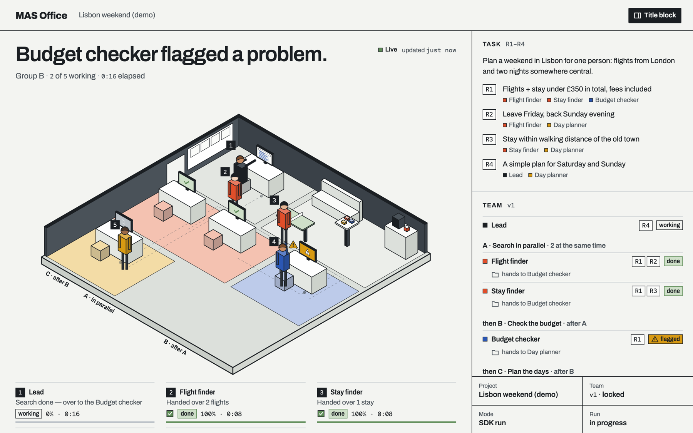
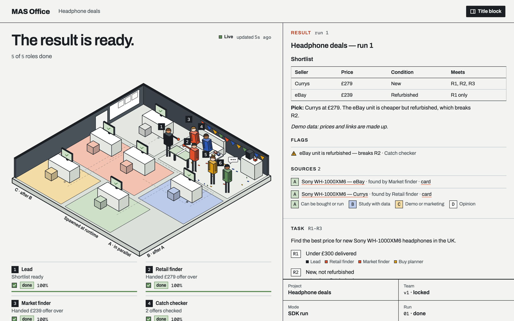

<div align="center">

# MAS Office

**See your multi-agent system work.** A framework-agnostic protocol and a live, animated office for AI agent teams.

[](https://github.com/weixijia/mas-office/actions/workflows/ci.yml)
[](LICENSE)
[](spec/README.md)
[](CONTRIBUTING.md)



</div>

Every agent gets a desk. When it works, searches, hands over, raises a flag or fails, the drawing changes — live. When the run is done, the result opens beside it, with every claim linked to its source.

MAS Office does not run your agents. Your framework does. MAS Office gives them a **small, written-down protocol** to report what they are doing, and a **panel** that turns it into a picture people actually look at.

- **Any producer.** OpenAI Agents SDK, LangGraph, Claude Agent SDK, Claude Code, your own Python or JS — or an AI coding assistant that only knows how to write files.
- **Zero dependencies.** The SDKs and CLI use only the standard library. The panel is plain HTML/JS with no build step and opens from `file://`.
- **Files are the interface.** An append-only `events.jsonl` per project, reduced deterministically into snapshots. Replay, diff, commit or attach them to a bug report.
- **Aligned with the standards.** Event types map to [AG-UI](https://docs.ag-ui.com), [OpenTelemetry GenAI](https://opentelemetry.io/docs/specs/semconv/gen-ai/) and [A2A](https://a2a-protocol.org) task states.

## Quick start

> The first tagged release is not on npm / PyPI yet — until then, run from source (Node ≥ 18; Python ≥ 3.10 for the Python SDK). Below, `mas-office` means `node packages/cli/bin/mas-office.js`.

```bash
git clone https://github.com/weixijia/mas-office && cd mas-office
npm install
node packages/cli/bin/mas-office.js demo
```

A browser opens with a five-agent team: two finders search in parallel, a checker catches a problem, a planner takes over, a helper is spawned at runtime and the lead writes the result. When everyone is done, the team celebrates and the result opens beside the drawing:



## Report from your own code

**Python** (`pip install -e packages/python` from the clone)

```python
from mas_office import Office

with Office(workspace="./runs") as office:
    run = office.project("headphone-deals", title="Headphone deals").run()
    finder = run.agent("finder", name="Retail finder", emoji="🔎")
    finder.working("Searching Currys", progress=30)
    finder.source(id="currys-xm6", title="Sony XM6 — Currys", url="https://www.currys.co.uk/", evidence="A")
    finder.handoff("lead")
    finder.done()
    run.result(markdown="## Shortlist\n- Currys — £279")
    run.finish()
```

**JavaScript** (the `@mas-office/sdk` workspace is linked by `npm install`)

```js
import { Office } from '@mas-office/sdk';

const office = new Office({ workspace: './runs' });
const run = office.project('headphone-deals', { title: 'Headphone deals' }).run();
const finder = run.agent('finder', { name: 'Retail finder', emoji: '🔎' });
finder.working('Searching Currys', { progress: 30 });
finder.done();
run.result({ markdown: '## Shortlist\n- Currys — £279' });
run.finish();
await office.close();
```

Then look at it:

```bash
node packages/cli/bin/mas-office.js serve ./runs --open    # live over HTTP + Server-Sent Events
# or just open ./runs/office/index.html after `mas-office init ./runs`
```

Several processes? Start `mas-office serve` once and point the SDKs at it with `Office(url="http://127.0.0.1:4747")`.

## Integrations

| Producer | How | Status |
|---|---|---|
| OpenAI Agents SDK (Python) | `mas_office.integrations.openai_agents.install(run)` — a `TracingProcessor` | experimental |
| LangGraph (Python) | `for chunk in stream_to_office(graph.stream(...), run): ...` | experimental |
| Claude Agent SDK (Python) | `ClaudeAgentOptions(hooks=office_hooks(run))` | experimental |
| Claude Code | `mas-office hook claude-code` as a hook command in `.claude/settings.json` ([setup](docs/integrations.md#claude-code-hooks-no-code)) | experimental |
| AI coding assistants (Claude Code, Codex, Antigravity, Gemini CLI, …) | `mas-office init --kit` — the assistant follows `AGENTS.md` and writes the files itself | stable |
| Anything else | the [protocol](spec/README.md): write events or snapshots | — |

Setup snippets for each: [`docs/integrations.md`](docs/integrations.md). CrewAI, AG-UI and OpenTelemetry ingest are next on the [roadmap](ROADMAP.md) — [help wanted](CONTRIBUTING.md#2-framework-integrations).

## No-code mode: let your AI assistant run the team

```bash
node packages/cli/bin/mas-office.js init --kit my-team
```

Open `my-team` in Claude Code, Codex, Antigravity or any coding agent and say *"Read SETUP.md and follow it."* The assistant interviews you, designs a team (who does what, what runs in parallel, who checks whom), lets you refine and lock it, then runs each role as a separate subagent — while the panel shows it all. This is the mode the classroom edition, [awesome-mas](https://github.com/weixijia/awesome-mas), is built on.

## How it works

```
your agents ──► events.jsonl ──► reducer ──► structure · status/* · state · result ──► panel
                 (append-only)    (spec §4)      (.json + .js twin per file)         (file:// or serve)
```

| Command | What it does |
|---|---|
| `mas-office demo` | simulated team in a temp workspace, served and opened |
| `mas-office serve [dir]` | panel at `/office/`, workspace read-only, `POST /v0/events`, live `GET /v0/stream` |
| `mas-office init [dir] [--kit]` | new workspace with the panel (and the AGENTS.md kit) |
| `mas-office validate [path]` | check snapshots and event logs against the JSON Schemas |
| `mas-office reduce <project>` | rebuild snapshots from the event log |
| `mas-office export --ag-ui <project>` | the log as AG-UI events (experimental) |

The full contract — layout, documents, 18 event types, state machine, reducer rules, HTTP endpoints — is in [`spec/README.md`](spec/README.md). Design notes: [`docs/architecture.md`](docs/architecture.md). Why it looks like this: [`docs/research/prior-art.md`](docs/research/prior-art.md), a cited survey of today's agent frameworks, standards and visualizers.

## How it compares

Tracing tools such as Langfuse, Arize Phoenix and AgentOps, and framework studios such as LangGraph Studio, are built for debugging one framework's spans and prompts. MAS Office is the opposite trade-off: a **team-level, at-a-glance** view (who is working, who is waiting for whom, what the checker caught) that works for **any** producer, needs no account or database, and is readable by people who will never open a trace. Use both — the event envelope carries `trace` ids for that.

## Project layout

```
spec/            protocol, JSON Schemas, conformance cases, RFCs
packages/js      @mas-office/sdk  (reducer, transports)
packages/cli     mas-office       (serve, validate, init, demo, …)
packages/python  mas-office       (reducer, transports, integrations)
panel/           the office panel (vanilla JS, no build)
kit/             AGENTS.md no-code mode
examples/        finished example workspaces
docs/            architecture, integrations, research
```

## Contributing

Integrations, panel ideas, spec feedback and bug reports are all welcome. Start with [CONTRIBUTING.md](CONTRIBUTING.md) — it has a checklist per lane (protocol, integrations, panel, SDKs). Spec changes follow a small [RFC process](spec/rfcs/README.md), and both reference implementations must pass the same [conformance cases](spec/conformance/). We use the DCO (`git commit -s`), not a CLA.

Please read the [Code of Conduct](CODE_OF_CONDUCT.md) and report security issues privately ([SECURITY.md](SECURITY.md)). Project roles and decisions: [GOVERNANCE.md](GOVERNANCE.md).

## Acknowledgements

MAS Office grew out of [awesome-mas](https://github.com/weixijia/awesome-mas), a classroom kit for teaching multi-agent systems to people who don't write code. The event model borrows from [AG-UI](https://github.com/ag-ui-protocol/ag-ui), [OpenTelemetry GenAI semantic conventions](https://github.com/open-telemetry/semantic-conventions-genai), [A2A](https://a2a-protocol.org) and LangGraph's event streaming; the idea of agents as little people at desks owes a lot to [pixel-agents](https://github.com/pixel-agents-hq/pixel-agents) and Stanford's [Generative Agents](https://github.com/joonspk-research/generative_agents). Fonts: Archivo and Red Hat Mono (SIL Open Font License).

## License

[MIT](LICENSE) © Xijia Wei and MAS Office contributors.
