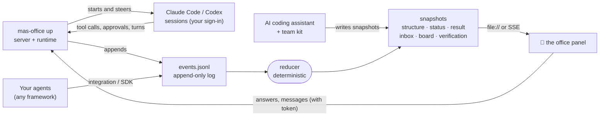

<div align="center">


# MAS Office

### An AI team you design, can watch, can steer, and that checks its own work.

Every role is a real Claude Code or Codex session on your computer, signed in by you. You lock the team's design, answer what needs you from one inbox, and read an answer whose claims checkers have judged one by one.<br>
The office view also works with Gemini CLI · OpenAI Agents SDK · LangGraph · Claude Agent SDK · your own Python or JS.

[](https://github.com/weixijia/mas-office/actions/workflows/ci.yml)
[](https://www.npmjs.com/package/mas-office)
[](LICENSE)
[](spec/README.md)
[](#-quick-start)
[](CONTRIBUTING.md)
[](https://github.com/weixijia/mas-office/stargazers)

[**Website & live examples**](https://www.xijiawei.com/mas-office/) · [**Why**](#-why-mas-office) · [**Run a team**](#-run-a-team) · [**Needs you**](#-what-needs-you) · [**Quick start**](#-quick-start) · [**Team kit**](#-no-code-team-kit) · [**Integrations**](#-plug-in-your-framework) · [**Protocol**](spec/README.md) · [**Roadmap**](#%EF%B8%8F-roadmap) · [**Contributing**](CONTRIBUTING.md) · [**中文**](README.zh-CN.md)


</div>

---

Most multi-agent tools help you run *more* agents. MAS Office helps you run them as a **team you can trust**: you design the roles and lock them, finders work in parallel, reviewers with a clean context send work back, and the Lead writes an answer where every claim is tagged with its sources, every link is checked and checkers judge each claim. Tool approvals, questions, checker flags and stage gates from every session land in one "Needs you" inbox. The whole time, each agent sits at a desk in a live office: click it to read its transcript or talk to its session.

> **Where it stands (v0.3.0).** MAS Office now runs the team: `mas-office up` starts a real Claude Code or Codex session for every role of a locked design, and the panel is where you steer it. The office view, the open event protocol with JS and Python SDKs, and the no-code team kit work as before. Not done yet: a raw-terminal tab you can take over, the evaluation runs and a desktop app. See the [roadmap](#%EF%B8%8F-roadmap).

```bash
npm install mas-office mas-office-runtime      # Node ≥ 18.14
claude auth login                              # sign in yourself; also `codex login` if a role runs on Codex
npx mas-office team lock ./office/deals        # your design in deals/mas/structure.json (or copy examples/price-compare)
npx mas-office up ./office --project deals --task "Find the best UK price for Sony WH-1000XM6 headphones"
# open the printed link; answer what lands in "Needs you"
```

Only want to look first? `npx mas-office demo` plays a simulated team: 30 seconds, no sign-in, nothing to set up.

## ✨ Why MAS Office

| | | |
|---|---|---|
| 🧭 **A team you design and lock** | You agree the roles, what runs in parallel, who reviews whom, which tools each role may use and which approvals the Lead may give. The lock signs the design; a run refuses a design that changed afterwards. | today |
| 📥 **One inbox for what needs you** | Tool approvals, questions, decisions, checker flags and stage gates from every session, answered in place, with how long each has waited and what it holds up. | today |
| 🎮 **Steer any agent from its desk** | Click a worker to read its live transcript and outputs, message its real session (steer, queue or interrupt) or stop it. Taking over its raw terminal comes later. | today · terminal next |
| 🔍 **Claims checked one by one** | The answer tags each claim with its sources. Every link is checked, checkers judge each claim, and sources are graded: **A** can be bought or run · **B** study with data · **C** demo or marketing · **D** opinion. | today |
| 🔁 **Follow-ups re-run only the roles needed** | Ask about the result and the Lead sends back just the roles your question needs. Each answer joins the result as a new round. | today |
| 🏢 **A picture, not a log** | Desks, handoff paths, parallel stages, reviewer lines, raised hands and a lounge for agents that are done. Readable by your PM, your class, or you at 2 a.m. | today |
| 🔌 **Any framework, an open protocol** | Integrations for the OpenAI Agents SDK, LangGraph, the Claude Agent SDK and Claude Code hooks; anything else appends JSON lines. The core package has no dependencies; no account, no cloud. | today |

## 🆚 Where it fits

MAS Office does not replace the tools below; it sits on top of them or next to them.

| You may already use | It is great at | MAS Office adds |
|---|---|---|
| Claude Code or Codex subagents and workflows | running many agents from one session | a team you design and lock, across vendors, with sources graded by independent checkers and an office you can watch |
| Parallel agent orchestrators (Orca, Conductor, Gas Town, Claude Squad) | many independent tasks side by side | roles that check each other, and one inbox for everything that needs you |
| Agent office views (pixel-agents and others) | coding sessions drawn as characters | team meaning: stages, handoffs, checker flags, graded evidence, follow-up rounds |
| Deep Research products | a cited report from one prompt | a team you shape and rerun, where checkers verify the sources instead of only listing them |
| Tracing platforms (Langfuse, Phoenix, AgentOps) | prompt, token and latency debugging | the team-level view for people who will never read a trace; every event can carry trace ids, so use both |

## 🧭 Run a team

**1. Design.** A team is `<project>/mas/structure.json` (or `.js`). Next to the roles, stages and handoffs of protocol 0.1, design v2 adds, all optional: a `backend` per role (`claude-code` or `codex`), the tools each role may use with `allow`, `ask` or `deny`, `reviewerOf` with a number of review rounds, gates (`plan`, `stage`, `final`), the approvals the Lead may give (`lead.delegate`) and a `budget`. [`examples/price-compare`](examples/price-compare/mas/structure.js) is a complete design: two finders on Claude Code, a checker on Codex that reviews both, and a gate before checking.

```jsonc
{"id": "catch-checker", "group": "B", "backend": "codex", "tools": ["web search"],
 "reviewerOf": ["sony-deal-finder", "similar-model-finder"], "cleanContext": true,
 "review": {"maxRounds": 2, "onExceed": "ask-human"}}
```

**2. Lock.** `mas-office team check <project>` lists every problem, `team lock` checks and signs the design, `team show` prints it as Markdown (roles, tools, who may approve what). A run refuses a design that changed after it was locked. The tools a role may use are compiled into its session's own options, and every tool call passes one decision point (`decideTool`): allowed, denied, or sent to the inbox. Codex roles run in a read-only sandbox, so every write they make is approved by that policy.

**3. Run.** `mas-office up <workspace> --project <p> --task "…"` (or start a run from the panel). A run goes like this:

1. The Lead, itself a real session, reads the task and the team and writes a brief for each role. The scheduler is plain code; it checks everything the Lead returns.
2. Stages run in order; roles inside a stage run in parallel, at most 3 sessions at once by default (`--max-parallel`).
3. A reviewer reads its targets' work with a clean context and accepts it or sends it back with a note. After the designed number of rounds, or when it escalates, you decide. Nothing is accepted silently.
4. Blocking gates hold the run where the design put them until you continue, send the stage back with a note, or stop the run.
5. The Lead writes the answer to `outputs/result.md`, tagging each claim with its sources. Every source link is checked, checkers judge each claim, and flags open when the design's thresholds are crossed (see [below](#-how-answers-are-checked)).
6. Ask a follow-up in the panel: the Lead answers from the files or sends back only the roles your question needs, and the answer becomes a new round.

A role that goes quiet is nudged once; if it stays quiet the Lead picks a recovery (retry, new brief, or ask you); after that you decide. Start `up` again after a crash or Ctrl+C and an unfinished run continues; requests the old process left open expire and the agent asks again.

**Limits today:** no raw-terminal tab or terminal take-over yet; with Codex 0.167.0 a Codex role's reads cannot be limited to the project folder; Codex reports tokens but no cost; interrupting a turn has not yet been exercised against the real Claude Code CLI; a pending approval is not re-attached after a restart (it expires and is asked again).

## 📥 What needs you

The panel's **Needs you** inbox collects everything that waits on a person, from every session: tool approvals, questions, decisions (a stuck role, a recovery), checker flags and gates. Each item shows how long it has waited, what it holds up and what happens if you don't answer, and you answer it in place. The office shows the same thing as raised hands on the desks.

- **Approvals you delegated** do not reach you: a `lead.delegate` rule either approves them by policy or lets the Lead decide within the tools and roles you listed. Every such decision is in the log with who made it. Gates, checker flags and questions marked for a person always come to you.
- **The agent drawer**: click a desk for the agent's transcript, its outputs and a chat box into its real session. A message can *steer* (delivered at the next break point), *queue* (after the current turn) or *interrupt*; a receipt shows what the session actually did with it. *Stop* ends the agent's turn.
- **Keyboard**: `N` jumps to the next agent that needs you, `I` to the inbox, `A` / `D` allow or decline the focused request, `1`–`9` open a stage, `?` lists the keys.
- **Who may answer**: `up` and `serve` print a panel link that carries a token. Only a browser opened from that link can answer requests, message agents or start runs; anywhere else (`file://`, the website, a static server) the panel is read-only. The examples and `?demo=1` work as before.
- **Sessions you opened yourself**: with [`mas-office hook claude-code`](docs/integrations.md#claude-code-hooks-no-code) installed, a permission prompt in your own Claude Code session also appears in the inbox. You answer it in your terminal; the panel only watches that session.

## 🔍 How answers are checked

1. **Claims.** The Lead's answer wraps each statement in `<claim id="c3" src="currys-xm6,ebay-xm6">…</claim>`; the sources are the role's source cards.
2. **Links.** Every source URL is checked by plain code, not a model: live, archived, dead or invented, or blocked by a bot wall. Private and local addresses are never fetched.
3. **Verdicts.** Checkers with a clean context, from the same or another vendor, judge each claim against its cited source: supported, partial, contradicted or unknown.
4. **Flags.** When the design's `verify.flagWhen` thresholds are crossed (for example one contradicted claim), a flag opens in the inbox.
5. **In the result**, claims are highlighted by verdict, a line counts the checked claims and live links, and "What the checkers caught" lists contradicted claims and work that reviewers sent back.

`mas-office verify <project>` runs steps 1 and 2 on any answer, including one written by another tool, and points at statements that carry no source. When the project has an event log, the findings are added to it and the panel shows them.

"Supported" means a checker judged that the cited page supports the claim; it does not mean the claim is true. We have not yet measured whether a team gives better answers than a single agent: [`eval/`](eval/README.md) holds the tasks, team designs and metrics for that comparison, and no evaluation runs have been made yet.

## ✅ Your own sign-in

- Each role runs the unmodified `claude` or `codex` installed on your computer: Claude Code through Anthropic's Agent SDK pointed at your `claude`, Codex through your `codex app-server`.
- You sign in yourself with `claude auth login` and `codex login`. MAS Office only asks whether you are signed in (`claude auth status`, Codex `account/read`). It never reads, stores or forwards credentials or tokens, and it never offers a login of its own.
- Sessions start with a minimal environment (your `PATH`, `HOME`, locale, terminal and proxy settings), not the server's own.
- Runs use your plan. At most 3 sessions work at once unless you change `--max-parallel`, and the panel shows the usage each program reports.
- The server listens on `127.0.0.1` by default.

The rules behind this are in [`CLAUDE.md`](CLAUDE.md) §3.

## 🚀 Quick start

**See it** (Node ≥ 18):

```bash
npx mas-office demo
```

A five-agent team plans a weekend in Lisbon: two finders search in parallel, a budget checker catches a problem, a planner takes over, a helper is spawned at runtime, and the lead writes the result.

**Run a locked team on real sessions** — the five lines at the top of this page, explained in [Run a team](#-run-a-team).

**Let your coding assistant lead the team, without the runtime** — see the [team kit](#-no-code-team-kit):

```bash
npx mas-office init --kit my-team
```

**Report a run from Python** (≥ 3.10; PyPI release coming soon):

```bash
pip install "mas-office @ git+https://github.com/weixijia/mas-office#subdirectory=packages/python"
```

```python
from mas_office import Office

with Office(workspace="./runs") as office:
    run = office.project("headphone-deals", title="Headphone deals").run()
    finder = run.agent("finder", name="Retail finder", emoji="🔎")
    finder.working("Searching Currys", progress=30)
    finder.source(id="currys", title="Sony XM6 — Currys", url="https://www.currys.co.uk/", evidence="A")
    finder.handoff("lead")
    finder.done()
    run.result(markdown="## Shortlist\n- Currys — £279")
    run.finish()
```

**Or from JavaScript / TypeScript:**

```bash
npm install mas-office
```

```js
import { Office } from 'mas-office';

const office = new Office({ workspace: './runs' });
const run = office.project('headphone-deals', { title: 'Headphone deals' }).run();
const finder = run.agent('finder', { name: 'Retail finder', emoji: '🔎' });
finder.working('Searching Currys', { progress: 30 });
finder.done();
run.result({ markdown: '## Shortlist\n- Currys — £279' });
run.finish();
await office.close();
```

**Then open the office:**

```bash
npx mas-office serve ./runs --open     # live updates over Server-Sent Events
```

Running agents in several processes or machines? Start `serve` once and point every SDK at it: `Office(url="http://127.0.0.1:4747")`.

## 🤖 No-code team kit

```bash
npx mas-office init --kit my-team
```

Open `my-team` in Claude Code, Codex, Gemini CLI or Antigravity and say *"Read SETUP.md and follow it."* Your assistant becomes the **Lead**:

1. **Describe** — it interviews you about the task and writes checkable requirements.
2. **Design** — it proposes a team: who finds, who checks, what runs in parallel. Reshape it in plain words.
3. **Lock** — each role gets its own job description; the office gives it a desk.
4. **Run** — each role runs as a separate subagent with a clean context while the office shows every step. The result slides out over the office, every claim linked to a graded source card.
5. **Follow up** — ask about the result; the Lead sends only the roles your question needs back to work and adds the answer as a new round.

In Claude Code, choose **"Yes, I trust this folder"** when you first open it: only a trusted folder applies the kit's settings. They give you:
- **The team in your terminal**: the status line shows who is working, who is done and what was flagged, with a link to the office.
- **A real browser for the roles** (`mas-browser`): a Chrome window with a temporary profile and none of your logins, confined to public addresses, for pages that block simple fetches. It needs Google Chrome.

This is also the engine behind the classroom edition, [**awesome-mas**](https://github.com/weixijia/awesome-mas).

## 🔌 Plug in your framework

<details open>
<summary><b>OpenAI Agents SDK</b> — one line</summary>

```python
from mas_office.integrations.openai_agents import install

run = Office(workspace="./runs").project("support", title="Support desk").run()
install(run)                                   # a TracingProcessor; OpenAI's own traces keep working
result = Runner.run_sync(triage_agent, "My order never arrived")
run.result(markdown=str(result.final_output)); run.finish()
```
Agents, function tools and handoffs become desks, tool uses and handoff paths.
</details>

<details>
<summary><b>LangGraph</b> — wrap your stream</summary>

```python
from mas_office.integrations.langgraph import stream_to_office

stream = graph.stream(inputs, stream_mode=["tasks", "updates", "custom"], subgraphs=True)
for chunk in stream_to_office(stream, run):    # chunks pass through unchanged
    ...
```
Nodes become agents (subgraph nodes get their parent); `get_stream_writer()({"say": "Reading 3 papers"})` sets the status line.
</details>

<details>
<summary><b>Claude Agent SDK</b> — hooks</summary>

```python
from mas_office.integrations.claude_agent_sdk import office_hooks

options = ClaudeAgentOptions(agents={...}, hooks=office_hooks(run))
async for message in query(prompt="Review this repo", options=options):
    ...
```
Subagents get desks; tool calls, permission prompts and failures show up live.
</details>

<details>
<summary><b>Claude Code</b> — zero code, just hooks</summary>

```bash
npm install -g mas-office
```
Add `mas-office hook claude-code --workspace ./.mas` as a hook command in `.claude/settings.json` ([full snippet](docs/integrations.md#claude-code-hooks-no-code)), then `mas-office serve ./.mas --open` and watch Claude Code and its subagents work.
</details>

<details>
<summary><b>Anything else</b> — the protocol</summary>

Append JSON lines to `<project>/mas/events.jsonl` (or `POST` them to `mas-office serve`):

```json
{"v":"0.1","seq":3,"ts":"2026-11-06T10:00:03Z","type":"handoff","agentId":"researcher","data":{"to":"critic"}}
```
That's the whole contract: [`spec/README.md`](spec/README.md). Validate with `npx mas-office validate`.
</details>

| Producer | Status | Guide |
|---|---|---|
| OpenAI Agents SDK (Python) | 🧪 experimental | [docs](docs/integrations.md#openai-agents-sdk-python) |
| LangGraph (Python) | 🧪 experimental | [docs](docs/integrations.md#langgraph-python) |
| Claude Agent SDK (Python) | 🧪 experimental | [docs](docs/integrations.md#claude-agent-sdk-python) |
| Claude Code (hooks) | 🧪 experimental | [docs](docs/integrations.md#claude-code-hooks-no-code) |
| AI coding assistants via `AGENTS.md` (Claude Code, Codex, Gemini CLI, Antigravity, Cursor…) | ✅ stable | [kit](kit/AGENTS.md) |
| CrewAI · AG-UI · OpenTelemetry · Google ADK · Mastra · CAMEL | 🙋 [help wanted](https://github.com/weixijia/mas-office/issues?q=is%3Aissue+is%3Aopen+label%3A%22help+wanted%22) | [how to write one](CONTRIBUTING.md#2-framework-integrations) |

## 🧠 How it works



- **Events in, pictures out.** Producers report what *happened*; the reducer computes what the panel shows *now*. Producers never have to track UI state.
- **Both directions, one log.** Protocol 0.2 adds requests that wait for a person (approvals, questions, decisions, checker flags, gates) and commands back to the agents (message, answer, assign, interrupt), each acknowledged. Commands sit in the same log as everything else, but a command never changes an agent's state; only what the session then reports does.
- **Same answer everywhere.** The JS and Python reducers are checked against the same 16 hand-written [conformance cases](spec/conformance/), so a log replays identically in both. A 0.1 log still reduces as before, apart from two new status fields.
- **Runs you can replay.** Each project is an append-only `events.jsonl`. Replay it, diff it, commit it, attach it to a bug report. The full conversation of each agent is kept separately in `mas/transcript/<agent>.jsonl`.

Details: [architecture](docs/architecture.md) · [runtime](docs/design/runtime.md) · [protocol](spec/README.md) · [protocol 0.2 RFC](spec/rfcs/0001-protocol-0.2.md) · [why it is designed this way](docs/research/prior-art.md).

## 🧰 The CLI

| Command | What it does |
|---|---|
| `mas-office demo` | a simulated team in a temp workspace, served and opened |
| `mas-office up [dir] --project <p> [--task "…"]` | run a locked team on real Claude Code and Codex sessions, with the panel and inbox (needs `mas-office-runtime`) |
| `mas-office serve [dir]` | panel at `/office/`, workspace read-only, `POST /v0/events`, `POST /v0/commands` (token), live `GET /v0/stream` with replay |
| `mas-office init [dir] [--kit]` | a new workspace with the panel (and the team kit) |
| `mas-office team check\|lock\|show <project>` | check a team design, lock and sign it, or print it as Markdown |
| `mas-office verify <project>` | list an answer's claims and check every source link |
| `mas-office validate [path]` | check snapshots and event logs against the JSON Schemas |
| `mas-office reduce <project>` | rebuild snapshots by replaying the event log |
| `mas-office export --ag-ui <project>` | the log as AG-UI events (experimental) |
| `mas-office hook claude-code` | turn Claude Code hook input into events (experimental) |

## 🗺️ Roadmap

Since v0.3.0 MAS Office **drives** the team, not only shows it. Each role runs in the unmodified Claude Code or Codex that you sign in to yourself; MAS Office never asks for, reads or stores your login. It plans, schedules and checks the team.

- [x] **v0.1–v0.2** — protocol, JS and Python SDKs, CLI with a live server, the office panel, four integrations, the team kit, result drawer, follow-up rounds, a browser for roles, the team in Claude Code's status line
- [x] **v0.3.0** — real Claude Code and Codex sessions (`mas-office-runtime`, `mas-office up`), protocol 0.2, the "Needs you" inbox, the agent drawer with chat, team design v2 with per-role permissions enforced in each session, a Lead that plans and recovers, claim-by-claim verification, the evaluation harness
- [ ] **Next** — a raw-terminal tab you can take over, attaching the official Codex TUI to a role's thread, moving the team kit onto the same engine, and the first evaluation runs against a single agent with the same budget
- [ ] **S4** — a user study of supervising agent teams, and a desktop app

Full list: [ROADMAP.md](ROADMAP.md). Have an idea? [Start a discussion](https://github.com/weixijia/mas-office/discussions).

## ♻️ Built on open source

We would rather integrate good work than rewrite it. [`references/manifest.json`](references/manifest.json) pins the open-source projects we learn from, and [`docs/design/reuse-map.md`](docs/design/reuse-map.md) records, for each part of MAS Office, which files of which project to read and whether we depend on it, adapt it or only take the idea. Adapted code keeps its attribution in [`THIRD_PARTY_NOTICES.md`](THIRD_PARTY_NOTICES.md).

## 💡 Made for

- **Research and decisions** — price comparisons, trip plans, literature and feasibility checks, product and policy questions, where a wrong fact costs you.
- **Demos and teaching** — show what a multi-agent system actually does, to people who will never read a trace. The [classroom edition](https://github.com/weixijia/awesome-mas) lets non-programmers design and run their own teams.
- **Building and debugging** — spot the agent that never hands over, the stage that runs serially by accident, the checker that never fires.
- **Research on human–agent teams** — replayable, diffable logs of agent collaboration in one simple format.

## 🤝 Contributing

MAS Office is built to be extended — a new framework integration is usually **one file and a test with fake payloads**. Look for [`good first issue`](https://github.com/weixijia/mas-office/issues?q=is%3Aissue+is%3Aopen+label%3A%22good+first+issue%22) and [`help wanted`](https://github.com/weixijia/mas-office/issues?q=is%3Aissue+is%3Aopen+label%3A%22help+wanted%22), then read [CONTRIBUTING.md](CONTRIBUTING.md). Coding agents start from [CLAUDE.md](CLAUDE.md). Spec changes follow a lightweight [RFC process](spec/rfcs/README.md). We use the DCO (`git commit -s`), not a CLA.

```bash
git clone https://github.com/weixijia/mas-office && cd mas-office
npm install && npm test                                   # JS SDK, CLI, runtime, panel
cd packages/python && pip install -e '.[dev]' && pytest   # Python SDK
PYTHONPATH=packages/python/src:eval python -m pytest eval -q   # evaluation harness (from the repo root)
node references/fetch.mjs                                 # optional: the pinned reference code
```

Please follow the [Code of Conduct](CODE_OF_CONDUCT.md) and report vulnerabilities privately ([SECURITY.md](SECURITY.md)).

If MAS Office helps you, **a ⭐ helps other people find it.**

<a href="https://star-history.com/#weixijia/mas-office&Date">
  
</a>

<a href="https://github.com/weixijia/mas-office/graphs/contributors">
  
</a>

## 📖 Citation

If you use MAS Office in research or teaching, please cite it:

```bibtex
@software{wei2026masoffice,
  author  = {Wei, Xijia and {MAS Office contributors}},
  title   = {{MAS Office}: a live office for designing, watching and checking AI agent teams},
  year    = {2026},
  url     = {https://github.com/weixijia/mas-office},
  version = {0.3.0}
}
```

## 🙏 Acknowledgements

MAS Office grew out of [awesome-mas](https://github.com/weixijia/awesome-mas), a classroom kit for teaching multi-agent systems to people who don't write code. The event model borrows from [AG-UI](https://github.com/ag-ui-protocol/ag-ui), the [OpenTelemetry GenAI semantic conventions](https://github.com/open-telemetry/semantic-conventions-genai), [A2A](https://a2a-protocol.org) and LangGraph's event streaming. The idea of agents as little people at desks owes a lot to [pixel-agents](https://github.com/pixel-agents-hq/pixel-agents) and Stanford's [Generative Agents](https://github.com/joonspk-research/generative_agents). The runtime, the inbox and the verification layer learn from many more open-source projects, listed in the [reuse map](docs/design/reuse-map.md); code we adapted is credited in [`THIRD_PARTY_NOTICES.md`](THIRD_PARTY_NOTICES.md). Fonts: Archivo and Red Hat Mono (SIL Open Font License).

## 📄 License

[MIT](LICENSE) © Xijia Wei and MAS Office contributors. Product names and logos are trademarks of their owners.
