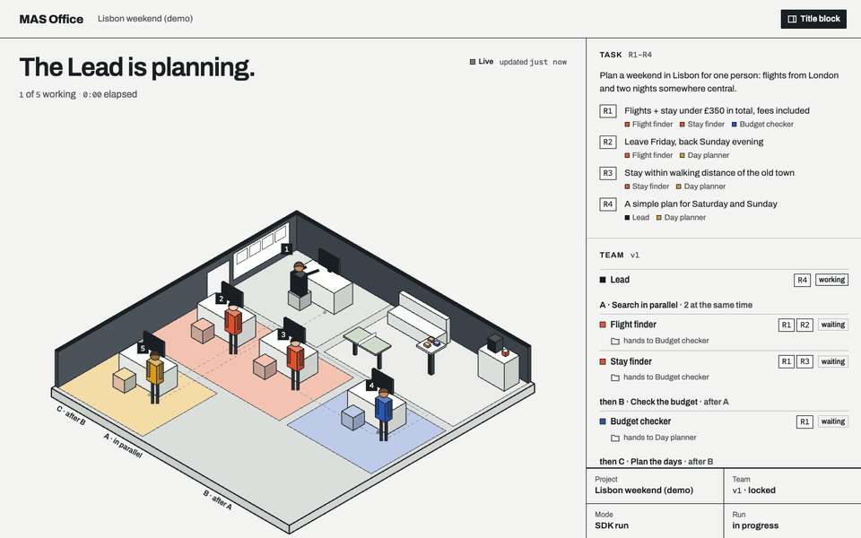
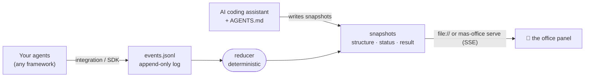

<div align="center">


# MAS Office

### Watch your AI agents work — live, in a little office.

An open protocol and an animated office panel for **any** multi-agent system:<br>
OpenAI Agents SDK · LangGraph · Claude Agent SDK · Claude Code · your own Python or JS.

[](https://github.com/weixijia/mas-office/actions/workflows/ci.yml)
[](https://www.npmjs.com/package/mas-office)
[](LICENSE)
[](spec/README.md)
[](#-why-mas-office)
[](CONTRIBUTING.md)
[](https://github.com/weixijia/mas-office/stargazers)

[**Website & live examples**](https://www.xijiawei.com/mas-office/) · [**Quick start**](#-quick-start) · [**Integrations**](#-plug-in-your-framework) · [**Protocol**](spec/README.md) · [**Docs**](docs/) · [**Roadmap**](ROADMAP.md) · [**Contributing**](CONTRIBUTING.md) · [**中文**](README.zh-CN.md)



</div>

---

Multi-agent systems are hard to *see*. Logs scroll past, traces nest ten levels deep, and nobody outside the engineering team can tell which agent is stuck, who handed what to whom, or what the checker just caught.

**MAS Office gives every agent a desk.** When an agent works, uses a tool, hands over, raises a flag or fails, the drawing changes in real time. When the run is done, the team celebrates and the result slides out over the office, every claim linked to its source. Your framework still runs the agents; MAS Office is the window into the room.

```bash
npx mas-office demo        # 30 seconds, no API key, nothing to set up
```

## ✨ Why MAS Office

| | |
|---|---|
| 🏢 **A picture, not a log** | Desks, handoff paths, parallel stages, flags and a lounge for agents that are done. Readable at a glance — by your PM, your class, or you at 2 a.m. |
| 🔌 **Any framework, three lines** | Drop-in integrations for the OpenAI Agents SDK, LangGraph, the Claude Agent SDK and Claude Code hooks. Everything else speaks the [protocol](spec/README.md). |
| 🪶 **Zero dependencies** | The npm and Python packages use only the standard library. No account, no database, no cloud. The panel is plain HTML and even opens from `file://`. |
| 📜 **An open, versioned protocol** | 18 event types mapped to [AG-UI](https://docs.ag-ui.com), [OpenTelemetry GenAI](https://opentelemetry.io/docs/specs/semconv/gen-ai/) and [A2A](https://a2a-protocol.org). A deterministic reducer, JSON Schemas, and conformance cases that both reference SDKs must pass. |
| ⏪ **Runs you can replay** | Each project is an append-only `events.jsonl`. Replay it, diff it, commit it, attach it to a bug report. |
| 🤖 **No-code mode** | Give `AGENTS.md` to Claude Code, Codex, Gemini CLI or Antigravity: the assistant designs a team with you and runs each role as a real subagent while the office shows it. Ask follow-up questions and the Lead sends only the roles it needs back to work. |

## 🚀 Quick start

**See it** (Node ≥ 18):

```bash
npx mas-office demo
```

A five-agent team plans a weekend in Lisbon: two finders search in parallel, a budget checker catches a problem, a planner takes over, a helper is spawned at runtime, and the lead writes the result.

**Use it from Python** (≥ 3.10; PyPI release coming soon):

```bash
pip install "mas-office @ git+https://github.com/weixijia/mas-office#subdirectory=packages/python"
```

```python
from mas_office import Office

with Office(workspace="./runs") as office:
    run = office.project("headphone-deals", title="Headphone deals").run()
    finder = run.agent("finder", name="Retail finder", emoji="🔎")
    finder.working("Searching Currys", progress=30)
    finder.source(id="currys", title="Sony XM6 — Currys", url="https://www.currys.co.uk/", evidence="A")
    finder.handoff("lead")
    finder.done()
    run.result(markdown="## Shortlist\n- Currys — £279")
    run.finish()
```

**Or from JavaScript / TypeScript:**

```bash
npm install mas-office
```

```js
import { Office } from 'mas-office';

const office = new Office({ workspace: './runs' });
const run = office.project('headphone-deals', { title: 'Headphone deals' }).run();
const finder = run.agent('finder', { name: 'Retail finder', emoji: '🔎' });
finder.working('Searching Currys', { progress: 30 });
finder.done();
run.result({ markdown: '## Shortlist\n- Currys — £279' });
run.finish();
await office.close();
```

**Then open the office:**

```bash
npx mas-office serve ./runs --open     # live updates over Server-Sent Events
```

Running agents in several processes or machines? Start `serve` once and point every SDK at it: `Office(url="http://127.0.0.1:4747")`.

## 🔌 Plug in your framework

<details open>
<summary><b>OpenAI Agents SDK</b> — one line</summary>

```python
from mas_office.integrations.openai_agents import install

run = Office(workspace="./runs").project("support", title="Support desk").run()
install(run)                                   # a TracingProcessor; OpenAI's own traces keep working
result = Runner.run_sync(triage_agent, "My order never arrived")
run.result(markdown=str(result.final_output)); run.finish()
```
Agents, function tools and handoffs become desks, tool uses and handoff paths.
</details>

<details>
<summary><b>LangGraph</b> — wrap your stream</summary>

```python
from mas_office.integrations.langgraph import stream_to_office

stream = graph.stream(inputs, stream_mode=["tasks", "updates", "custom"], subgraphs=True)
for chunk in stream_to_office(stream, run):    # chunks pass through unchanged
    ...
```
Nodes become agents (subgraph nodes get their parent); `get_stream_writer()({"say": "Reading 3 papers"})` sets the status line.
</details>

<details>
<summary><b>Claude Agent SDK</b> — hooks</summary>

```python
from mas_office.integrations.claude_agent_sdk import office_hooks

options = ClaudeAgentOptions(agents={...}, hooks=office_hooks(run))
async for message in query(prompt="Review this repo", options=options):
    ...
```
Subagents get desks; tool calls, permission prompts and failures show up live.
</details>

<details>
<summary><b>Claude Code</b> — zero code, just hooks</summary>

```bash
npm install -g mas-office
```
Add `mas-office hook claude-code --workspace ./.mas` as a hook command in `.claude/settings.json` ([full snippet](docs/integrations.md#claude-code-hooks-no-code)), then `mas-office serve ./.mas --open` and watch Claude Code and its subagents work.
</details>

<details>
<summary><b>Anything else</b> — the protocol</summary>

Append JSON lines to `<project>/mas/events.jsonl` (or `POST` them to `mas-office serve`):

```json
{"v":"0.1","seq":3,"ts":"2026-11-06T10:00:03Z","type":"handoff","agentId":"researcher","data":{"to":"critic"}}
```
That's the whole contract: [`spec/README.md`](spec/README.md). Validate with `npx mas-office validate`.
</details>

| Producer | Status | Guide |
|---|---|---|
| OpenAI Agents SDK (Python) | 🧪 experimental | [docs](docs/integrations.md#openai-agents-sdk-python) |
| LangGraph (Python) | 🧪 experimental | [docs](docs/integrations.md#langgraph-python) |
| Claude Agent SDK (Python) | 🧪 experimental | [docs](docs/integrations.md#claude-agent-sdk-python) |
| Claude Code (hooks) | 🧪 experimental | [docs](docs/integrations.md#claude-code-hooks-no-code) |
| AI coding assistants via `AGENTS.md` (Claude Code, Codex, Gemini CLI, Antigravity, Cursor…) | ✅ stable | [kit](kit/AGENTS.md) |
| CrewAI · AG-UI · OpenTelemetry · Google ADK · Mastra · CAMEL | 🙋 [help wanted](https://github.com/weixijia/mas-office/issues?q=is%3Aissue+is%3Aopen+label%3A%22help+wanted%22) | [how to write one](CONTRIBUTING.md#2-framework-integrations) |

## 🤖 No-code mode: let your AI assistant build the team

```bash
npx mas-office init --kit my-team
```

Open `my-team` in Claude Code, Codex, Gemini CLI or Antigravity and say *"Read SETUP.md and follow it."* The assistant interviews you about the task, proposes a team (who does what, what runs in parallel, who checks whom), lets you reshape it in plain words, locks it, and runs each role as a separate subagent with its own context — while the office shows every step. Then ask follow-up questions about the result: the Lead decides which roles a question needs, sends only those back to work (fresh agents that build on their earlier work), and adds the answer as a new round. This is the engine behind the classroom edition, [**awesome-mas**](https://github.com/weixijia/awesome-mas).

In Claude Code, choose **"Yes, I trust this folder"** when you first open it: only a trusted folder applies the kit's settings. They give you:
- **The team in your terminal**: the status line shows who is working, who is done and what was flagged, with a link to the office.
- **A real browser for the roles** (`mas-browser`): a Chrome window with a temporary profile and none of your logins, for pages that block simple fetches. It needs Google Chrome.

## 🧠 How it works



- **Events in, pictures out.** Producers report what *happened*; the reducer computes what the panel shows *now*. Producers never have to track UI state.
- **Same answer everywhere.** The JS and Python reducers are checked against the same hand-written [conformance cases](spec/conformance/), so a log replays identically in both.
- **Best-effort reporting.** Emission failures are warned and dropped. File transport writes synchronously; HTTP transport batches events in the background.

Details: [architecture](docs/architecture.md) · [protocol](spec/README.md) · [why it is designed this way](docs/research/prior-art.md) (a cited survey of 14 agent frameworks, 4 standards and today's visualizers).

## 🧰 The CLI

| Command | What it does |
|---|---|
| `mas-office demo` | a simulated team in a temp workspace, served and opened |
| `mas-office serve [dir]` | panel at `/office/`, workspace read-only, `POST /v0/events`, live `GET /v0/stream` |
| `mas-office init [dir] [--kit]` | a new workspace with the panel (and the `AGENTS.md` kit) |
| `mas-office validate [path]` | check snapshots and event logs against the JSON Schemas |
| `mas-office reduce <project>` | rebuild snapshots by replaying the event log |
| `mas-office export --ag-ui <project>` | the log as AG-UI events (experimental) |
| `mas-office hook claude-code` | turn Claude Code hook input into events (experimental) |

## 🆚 How it compares

MAS Office is not a tracing platform — it's the view you put on the big screen. Use it *alongside* your tracer: every event can carry `trace` ids.

| | **MAS Office** | Tracing platforms<br><sub>Langfuse, Phoenix, AgentOps</sub> | Framework studios<br><sub>LangGraph Studio, AutoGen Studio</sub> |
|---|:---:|:---:|:---:|
| Team-level live view (who works, who waits, who checks) | ✅ | ➖ trace trees | ✅ graph |
| Works across frameworks | ✅ | ✅ | ➖ one framework |
| No account, server or database | ✅ | ➖ | ✅ |
| Readable by non-engineers | ✅ | ❌ | ➖ |
| Open, file-based protocol you can write by hand | ✅ | ➖ OTel | ❌ |
| Prompt, token and latency debugging | ❌ use a tracer | ✅ | ✅ |

## 💡 Made for

- **Demos and talks** — show what your multi-agent system actually does, in real time, to people who will never read a trace.
- **Building and debugging** — spot the agent that never hands over, the stage that runs serially by accident, the checker that never fires.
- **Teaching** — the [classroom edition](https://github.com/weixijia/awesome-mas) lets non-programmers design and run their own agent teams.
- **Research** — replayable, diffable logs of agent collaboration in one simple format.

## 🗺️ Roadmap

Next, MAS Office learns to **drive** the team, not only show it: a research team you design, can watch, and that checks its own work, running on the AI subscriptions you already have. Each role runs in an official coding agent you are already signed in to (`claude -p`, `codex exec`, …); MAS Office does the team part.

- [x] Protocol 0.1, JS + Python SDKs, CLI with live server, panel, 4 integrations, no-code kit
- [x] 0.2: result drawer, follow-up rounds, a real browser for roles, the team in Claude Code's status line
- [ ] M0: an evaluation of one agent vs a MAS team on research tasks; role backends for `claude -p` and `codex exec`; chat and office in one terminal screen
- [ ] M1: `mas run` — the team runs itself, with per-role tools and permissions, checker rework and resume
- [ ] M2–M4: any coding agent as the Lead (MCP), one-window terminal and desktop apps
- [ ] Any time: CrewAI, AG-UI and OpenTelemetry ingest; replay scrubber; PyPI release

Full list: [ROADMAP.md](ROADMAP.md). Have an idea? [Start a discussion](https://github.com/weixijia/mas-office/discussions).

## 🤝 Contributing

MAS Office is small on purpose and built to be extended — a new framework integration is usually **one file and a test with fake payloads**. Look for [`good first issue`](https://github.com/weixijia/mas-office/issues?q=is%3Aissue+is%3Aopen+label%3A%22good+first+issue%22) and [`help wanted`](https://github.com/weixijia/mas-office/issues?q=is%3Aissue+is%3Aopen+label%3A%22help+wanted%22), then read [CONTRIBUTING.md](CONTRIBUTING.md): it has a checklist for each lane (protocol, integrations, panel, SDKs). Spec changes follow a lightweight [RFC process](spec/rfcs/README.md). We use the DCO (`git commit -s`), not a CLA.

```bash
git clone https://github.com/weixijia/mas-office && cd mas-office
npm install && npm test                                   # JS SDK, CLI, panel
cd packages/python && pip install -e '.[dev]' && pytest   # Python SDK
```

Please follow the [Code of Conduct](CODE_OF_CONDUCT.md) and report vulnerabilities privately ([SECURITY.md](SECURITY.md)).

If MAS Office helps you, **a ⭐ helps other people find it.**

<a href="https://star-history.com/#weixijia/mas-office&Date">
  
</a>

<a href="https://github.com/weixijia/mas-office/graphs/contributors">
  
</a>

## 📖 Citation

If you use MAS Office in research or teaching, please cite it:

```bibtex
@software{wei2026masoffice,
  author  = {Wei, Xijia and {MAS Office contributors}},
  title   = {{MAS Office}: an open protocol and live office view for multi-agent systems},
  year    = {2026},
  url     = {https://github.com/weixijia/mas-office},
  version = {0.2.2}
}
```

## 🙏 Acknowledgements

MAS Office grew out of [awesome-mas](https://github.com/weixijia/awesome-mas), a classroom kit for teaching multi-agent systems to people who don't write code. The event model borrows from [AG-UI](https://github.com/ag-ui-protocol/ag-ui), the [OpenTelemetry GenAI semantic conventions](https://github.com/open-telemetry/semantic-conventions-genai), [A2A](https://a2a-protocol.org) and LangGraph's event streaming. The idea of agents as little people at desks owes a lot to [pixel-agents](https://github.com/pixel-agents-hq/pixel-agents) and Stanford's [Generative Agents](https://github.com/joonspk-research/generative_agents). Fonts: Archivo and Red Hat Mono (SIL Open Font License).

## 📄 License

[MIT](LICENSE) © Xijia Wei and MAS Office contributors.
