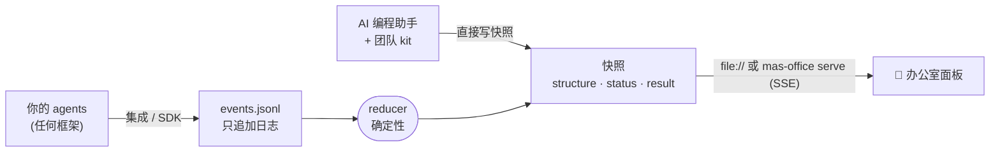

<div align="center">


# MAS Office

### AI agent 团队的实时办公室。

设计一支 agent 团队，看每个角色在工位上干活，拿到一份每个来源都经过独立 checker 核对和分级的结果。<br>
跑在你已经在用的 AI 工具里：Claude Code · Codex · Gemini CLI · OpenAI Agents SDK · LangGraph · Claude Agent SDK · 你自己的 Python / JS。

[](https://github.com/weixijia/mas-office/actions/workflows/ci.yml)
[](https://www.npmjs.com/package/mas-office)
[](LICENSE)
[](spec/README.md)
[](https://github.com/weixijia/mas-office/stargazers)

[**项目网站与在线示例**](https://www.xijiawei.com/mas-office/) · [**为什么**](#-为什么用-mas-office) · [**快速开始**](#-快速开始) · [**团队 kit**](#-无代码团队-kit) · [**框架接入**](#-接入你的框架) · [**协议**](spec/README.md) · [**路线图**](#️-路线图) · [**参与贡献**](CONTRIBUTING.md) · [**English**](README.md)


</div>

---

大多数多 agent 工具帮你跑**更多**的 agent；MAS Office 帮你把它们跑成一支**信得过的团队**：角色由你设计并锁定，finder 并行查找，上下文干净的 checker 专门挑错，Lead 写出的答案里每条结论都链接到一张 A–D 分级的来源卡。整个过程中，每个 agent 都坐在实时办公室的工位上：谁在干活、谁把什么交给了谁、checker 刚抓到了什么，一眼就能看到。

> **现在的状态（v0.2.2）**：MAS Office 目前是一个实时办公室视图、一个带 JS 和 Python SDK 的开放事件协议，以及一个无代码团队 kit，能让 Claude Code、Codex、Gemini CLI 或 Antigravity 当你团队的 Lead。下一步，它会自己启动并引导真实的 Claude Code 和 Codex 会话，把所有需要你处理的事集中到一个收件箱。见[路线图](#️-路线图)。

```bash
npx mas-office demo        # 30 秒，不需要 API key，不需要配置
```

## ✨ 为什么用 MAS Office

| | | |
|---|---|---|
| 🧭 **你设计并锁定的团队** | 角色、哪些并行、谁检查谁，由你确认。锁定后的团队每次按同样方式运行，下周还能原样再跑一次。 | 现在 |
| 🔍 **每个来源都被核对和分级** | checker 用干净的上下文开工，标出问题，并给每个来源分级：**A** 能买到或能跑通 · **B** 有数据的研究 · **C** 演示或营销 · **D** 观点。 | 现在 |
| 🔁 **追问只派回需要的角色** | 对结果提问时，Lead 只把这个问题需要的角色派回去干活，答案作为新一轮加入结果。 | 现在 |
| 🏢 **是画面，不是日志** | 工位、交接路线、并行阶段、问题标记，还有给干完活的 agent 休息的休息区。产品经理、学生、凌晨两点的你都能看懂。 | 现在 |
| 🔌 **任何框架，开放协议** | OpenAI Agents SDK、LangGraph、Claude Agent SDK、Claude Code hooks 都有现成集成，其他的追加 JSON 行即可。零依赖，不要账号，不要云。 | 现在 |
| 📥 **一个收件箱装下所有需要你的事** | 所有 agent 的工具审批、决策、checker 标记和阶段关口，就地答复，还能看到每件事等了多久。 | 下一步 |
| 🎮 **在工位上直接引导任何 agent** | 点一个员工，看它的实时记录，直接和它背后真实的 Claude Code 或 Codex 会话对话，或者接手它的终端。 | 下一步 |

## 🆚 和其他工具的关系

MAS Office 不替代下面这些工具，而是架在它们之上或放在旁边用。

| 你可能已经在用 | 它擅长 | MAS Office 补上的 |
|---|---|---|
| Claude Code / Codex 的 subagent 和 workflow | 在一个会话里跑很多 agent | 你设计并锁定的、可跨厂商的团队，独立 checker 核对并分级的来源，以及看得见的办公室 |
| 并行 agent 编排器（Orca、Conductor、Gas Town、Claude Squad） | 让很多独立任务并排跑 | 互相检查的角色，以及（下一步）一个装下所有需要你的事的收件箱 |
| agent 办公室视图（pixel-agents 等） | 把编程会话画成小人 | 团队语义：阶段、交接、checker 标记、分级证据、追问轮次 |
| Deep Research 产品 | 一句话出一份带引用的报告 | 你能塑造和重跑的团队，checker 去核对来源，而不只是列出来源 |
| Tracing 平台（Langfuse、Phoenix、AgentOps） | prompt、token、延迟调试 | 给不看 trace 的人看的团队视图；每个事件都能带 trace id，两者一起用 |

## 🚀 快速开始

**先看效果**（Node ≥ 18）：

```bash
npx mas-office demo
```

一个五人团队规划里斯本周末：两个搜索员并行工作，预算检查员发现问题，规划员接手，运行中临时加入一个帮手，最后由 Lead 写出结果。

**在 Python 里用**（≥ 3.10，PyPI 版本即将发布）：

```bash
pip install "mas-office @ git+https://github.com/weixijia/mas-office#subdirectory=packages/python"
```

```python
from mas_office import Office

with Office(workspace="./runs") as office:
    run = office.project("headphone-deals", title="Headphone deals").run()
    finder = run.agent("finder", name="Retail finder", emoji="🔎")
    finder.working("Searching Currys", progress=30)
    finder.handoff("lead")
    finder.done()
    run.result(markdown="## Shortlist\n- Currys — £279")
    run.finish()
```

**在 JavaScript / TypeScript 里用**：`npm install mas-office`，然后 `import { Office } from 'mas-office'`，API 与 Python 一致（camelCase）。

**打开办公室：**

```bash
npx mas-office serve ./runs --open     # 通过 Server-Sent Events 实时更新
```

## 🤖 无代码团队 kit

```bash
npx mas-office init --kit my-team
```

用 Claude Code、Codex、Gemini CLI 或 Antigravity 打开 `my-team`，说一句 *"Read SETUP.md and follow it."*，你的助手就成了 **Lead**：

1. **描述**：它就任务访谈你，写出可检查的需求。
2. **设计**：它提出一支团队：谁查找、谁检查、哪些并行。用大白话就能改。
3. **锁定**：每个角色有自己的岗位说明，办公室给它一张工位。
4. **运行**：每个角色作为上下文干净的独立 subagent 运行，办公室实时显示每一步。结果从右侧滑出，浮在办公室上方，每条结论都链接到分级的来源卡。
5. **追问**：对结果提问，Lead 只把需要的角色派回去，答案作为新一轮加入。

在 Claude Code 里第一次打开时选 **"Yes, I trust this folder"**，只有被信任的文件夹才会应用 kit 的设置：终端状态行会显示团队（谁在干活、谁做完了、谁被标了问题，并附办公室链接）；角色还能用一个真实的浏览器（`mas-browser`：临时 profile，不带你的任何登录，只能访问公网地址），用来打开拒绝简单抓取的网页，需要安装 Google Chrome。

这也是课堂版 [**awesome-mas**](https://github.com/weixijia/awesome-mas) 背后的引擎。

## 🔌 接入你的框架

| 框架 | 接入方式 | 状态 |
|---|---|---|
| OpenAI Agents SDK | `install(run)`，一个 `TracingProcessor` | 🧪 experimental |
| LangGraph | `for chunk in stream_to_office(graph.stream(...), run)` | 🧪 experimental |
| Claude Agent SDK | `ClaudeAgentOptions(hooks=office_hooks(run))` | 🧪 experimental |
| Claude Code | 在 `.claude/settings.json` 里加 `mas-office hook claude-code` | 🧪 experimental |
| AI 编程助手（`AGENTS.md`） | `npx mas-office init --kit my-team` | ✅ stable |
| CrewAI · AG-UI · OpenTelemetry · Google ADK · Mastra | 🙋 [欢迎贡献](https://github.com/weixijia/mas-office/issues?q=is%3Aissue+is%3Aopen+label%3A%22help+wanted%22) | — |

每个框架的完整示例见 [`docs/integrations.md`](docs/integrations.md)。

## 🧠 工作原理



- **事件进，画面出**：producer 只报告"发生了什么"，reducer 算出面板"现在该显示什么"。
- **处处结果一致**：JS 和 Python 两套 reducer 用同一批手工推算的 [conformance 用例](spec/conformance/)检验。
- **能回放的运行**：每个项目是一份只追加的 `events.jsonl`，可以回放、diff、提交，或附到 bug 报告里。
- **下一步：双向**：协议 0.2 增加"等人处理的请求"（审批、决策、checker 标记）和"发回给 agent 的命令"（发消息、答复、派活、中断），让办公室不只显示团队，还能引导团队。

## 🗺️ 路线图

下一步，MAS Office 要**驱动**团队，而不只是显示团队。每个角色都跑在你自己登录的、未经修改的 Claude Code 或 Codex 里；MAS Office 从不索取、读取或保存你的登录信息，只负责规划、调度和检查团队。

- [x] **v0.1–v0.2**：协议、JS / Python SDK、带实时服务的 CLI、办公室面板、4 个框架接入、团队 kit、结果抽屉、追问轮次、角色浏览器、Claude Code 状态行
- [ ] **S0**：从办公室启动并引导真实的 Claude Code 和 Codex 会话：看到一个卡住，点它，批准或回复，看它继续
- [ ] **S1**：协议 0.2、收件箱、在工位上和任何 agent 对话、可接手的原始终端
- [ ] **S2**：Lead 按锁定的团队设计调度，每个会话里强制执行按角色的权限
- [ ] **S3**：逐条结论核对（结论 → 来源 → 链接检查 → checker 判定），并和同等预算的单个 agent 做评测对比
- [ ] **S4**：一项关于监督 agent 团队的用户研究，以及桌面 app

完整列表见 [ROADMAP.md](ROADMAP.md)。

## ♻️ 站在开源的肩膀上

能整合好的开源成果，我们就不重写。[`references/manifest.json`](references/manifest.json) 固定了我们参考的开源项目，[`docs/design/reuse-map.md`](docs/design/reuse-map.md) 记录 MAS Office 的每个部分该读哪些项目的哪些文件，以及是依赖、改编还是只借思路。改编的代码在 [`THIRD_PARTY_NOTICES.md`](THIRD_PARTY_NOTICES.md) 里保留署名。

## 🤝 参与贡献

一个新框架集成通常只是**一个文件加一个用假数据驱动的测试**。从 [`good first issue`](https://github.com/weixijia/mas-office/issues?q=is%3Aissue+is%3Aopen+label%3A%22good+first+issue%22) 开始，再读 [CONTRIBUTING.md](CONTRIBUTING.md)；coding agent 从 [CLAUDE.md](CLAUDE.md) 开始。协议变更走轻量 [RFC 流程](spec/rfcs/README.md)，提交用 DCO（`git commit -s`）。

如果 MAS Office 对你有帮助，**点个 ⭐ 能让更多人看到它。**

## 🙏 致谢

MAS Office 源自 [awesome-mas](https://github.com/weixijia/awesome-mas)：一个教不写代码的人设计多智能体系统的课堂套件。事件模型借鉴了 AG-UI、OpenTelemetry GenAI、A2A 和 LangGraph 的事件流；"agent 是工位上的小人"这个想法受 pixel-agents 和斯坦福 Generative Agents 启发。下一阶段参考的更多开源项目列在[复用地图](docs/design/reuse-map.md)里。

## 📄 License

[MIT](LICENSE) © Xijia Wei and MAS Office contributors。产品名称和 logo 归各自所有者。
