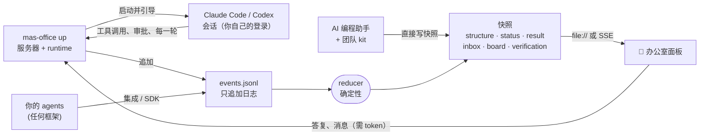

<div align="center">


# MAS Office

### 一支你自己设计、看得见、管得住、会自己核对工作的 AI 团队。

每个角色都是你电脑上一个真实的 Claude Code 或 Codex 会话，由你自己登录。你锁定团队设计，在一个收件箱里处理所有需要你的事，拿到的答案里每条结论都经过 checker 逐条判定。<br>
办公室视图也能接 Gemini CLI · OpenAI Agents SDK · LangGraph · Claude Agent SDK · 你自己的 Python / JS。

[](https://github.com/weixijia/mas-office/actions/workflows/ci.yml)
[](https://www.npmjs.com/package/mas-office)
[](LICENSE)
[](spec/README.md)
[](https://github.com/weixijia/mas-office/stargazers)

[**项目网站与在线示例**](https://www.xijiawei.com/mas-office/) · [**为什么**](#-为什么用-mas-office) · [**运行团队**](#-运行一支团队) · [**需要你**](#-需要你处理的事) · [**快速开始**](#-快速开始) · [**团队 kit**](#-无代码团队-kit) · [**框架接入**](#-接入你的框架) · [**协议**](spec/README.md) · [**路线图**](#️-路线图) · [**参与贡献**](CONTRIBUTING.md) · [**English**](README.md)


</div>

---

大多数多 agent 工具帮你跑**更多**的 agent；MAS Office 帮你把它们跑成一支**信得过的团队**：角色由你设计并锁定，finder 并行查找，上下文干净的 reviewer 把不合格的工作打回去，Lead 写出的答案里每条结论都标出它的来源，每个链接都被检查，checker 逐条判定结论。所有会话的工具审批、提问、checker 标记和阶段关口都进同一个 "Needs you" 收件箱。整个过程中，每个 agent 都坐在实时办公室的工位上：点它就能看它的记录，或者直接和它的会话对话。

> **现在的状态（v0.3.0）**：MAS Office 现在能运行团队了：`mas-office up` 为锁定设计里的每个角色启动一个真实的 Claude Code 或 Codex 会话，面板就是你引导它们的地方。办公室视图、带 JS 和 Python SDK 的开放事件协议、无代码团队 kit 照常可用。还没做的：可接手的原始终端 tab、评测运行、桌面 app。见[路线图](#️-路线图)。

```bash
npm install mas-office mas-office-runtime      # Node ≥ 18.14
claude auth login                              # 自己登录；有角色跑在 Codex 上时还要 `codex login`
npx mas-office team lock ./office/deals        # 你的设计在 deals/mas/structure.json（或复制 examples/price-compare）
npx mas-office up ./office --project deals --task "Find the best UK price for Sony WH-1000XM6 headphones"
# 打开打印出来的链接，处理 "Needs you" 里的事
```

只想先看看？`npx mas-office demo` 播放一支模拟团队：30 秒，不需要登录，不需要配置。

## ✨ 为什么用 MAS Office

| | | |
|---|---|---|
| 🧭 **你设计并锁定的团队** | 角色、哪些并行、谁审查谁、每个角色能用哪些工具、Lead 能替你批准哪些事，由你确认。锁定会给设计签名；设计在锁定后被改过，运行就会拒绝它。 | 现在 |
| 📥 **一个收件箱装下所有需要你的事** | 所有会话的工具审批、提问、决策、checker 标记和阶段关口，就地答复，还能看到每件事等了多久、卡住了什么。 | 现在 |
| 🎮 **在工位上直接引导任何 agent** | 点一个员工，看它的实时记录和产出，给它背后真实的会话发消息（steer、queue 或 interrupt），或者让它停下。接手它的原始终端以后再做。 | 现在 · 终端下一步 |
| 🔍 **结论逐条核对** | 答案给每条结论标出来源。每个链接都被检查，checker 逐条判定结论，来源还会分级：**A** 能买到或能跑通 · **B** 有数据的研究 · **C** 演示或营销 · **D** 观点。 | 现在 |
| 🔁 **追问只派回需要的角色** | 对结果提问时，Lead 只把这个问题需要的角色派回去干活，答案作为新一轮加入结果。 | 现在 |
| 🏢 **是画面，不是日志** | 工位、交接路线、并行阶段、reviewer 连线、举起的手，还有给干完活的 agent 休息的休息区。产品经理、学生、凌晨两点的你都能看懂。 | 现在 |
| 🔌 **任何框架，开放协议** | OpenAI Agents SDK、LangGraph、Claude Agent SDK、Claude Code hooks 都有现成集成，其他的追加 JSON 行即可。核心包零依赖，不要账号，不要云。 | 现在 |

## 🆚 和其他工具的关系

MAS Office 不替代下面这些工具，而是架在它们之上或放在旁边用。

| 你可能已经在用 | 它擅长 | MAS Office 补上的 |
|---|---|---|
| Claude Code / Codex 的 subagent 和 workflow | 在一个会话里跑很多 agent | 你设计并锁定的、可跨厂商的团队，独立 checker 核对并分级的来源，以及看得见的办公室 |
| 并行 agent 编排器（Orca、Conductor、Gas Town、Claude Squad） | 让很多独立任务并排跑 | 互相检查的角色，以及一个装下所有需要你的事的收件箱 |
| agent 办公室视图（pixel-agents 等） | 把编程会话画成小人 | 团队语义：阶段、交接、checker 标记、分级证据、追问轮次 |
| Deep Research 产品 | 一句话出一份带引用的报告 | 你能塑造和重跑的团队，checker 去核对来源，而不只是列出来源 |
| Tracing 平台（Langfuse、Phoenix、AgentOps） | prompt、token、延迟调试 | 给不看 trace 的人看的团队视图；每个事件都能带 trace id，两者一起用 |

## 🧭 运行一支团队

**1. 设计。** 团队就是 `<project>/mas/structure.json`（或 `.js`）。在协议 0.1 的角色、阶段和交接之外，设计 v2 新增了一组可选字段：每个角色的 `backend`（`claude-code` 或 `codex`）、每个角色能用的工具及其 `allow` / `ask` / `deny`、带审查轮数的 `reviewerOf`、关口（`plan`、`stage`、`final`）、Lead 能替你批准的事（`lead.delegate`），以及 `budget`。[`examples/price-compare`](examples/price-compare/mas/structure.js) 是一份完整的设计：两个 finder 跑在 Claude Code 上，一个跑在 Codex 上的 checker 审查这两个人，检查阶段之前有一道关口。

```jsonc
{"id": "catch-checker", "group": "B", "backend": "codex", "tools": ["web search"],
 "reviewerOf": ["sony-deal-finder", "similar-model-finder"], "cleanContext": true,
 "review": {"maxRounds": 2, "onExceed": "ask-human"}}
```

**2. 锁定。** `mas-office team check <project>` 列出所有问题，`team lock` 检查后给设计签名，`team show` 把设计打印成 Markdown（角色、工具、谁能批准什么）。设计在锁定后被改过，运行就会拒绝它。每个角色能用的工具会编译进它所在会话自己的选项，每一次工具调用都经过同一个决策点（`decideTool`）：放行、拒绝，或者送进收件箱。Codex 角色跑在只读 sandbox 里，所以它的每一次写入都要经过这套策略批准。

**3. 运行。** `mas-office up <workspace> --project <p> --task "…"`（也可以在面板里发起）。一次运行的过程：

1. Lead 本身也是一个真实会话，它读任务和团队，给每个角色写一份 brief。调度器是普通代码，Lead 返回的所有内容都会被它校验。
2. 各阶段按顺序进行；同一阶段内的角色并行，默认最多同时 3 个会话（`--max-parallel`）。
3. reviewer 用干净的上下文读它负责的人的产出，接受或附上意见打回。超过设计的轮数，或者它选择上报，就由你决定。不会有任何东西被悄悄接受。
4. 阻塞型关口会在设计的位置停住运行，直到你选择继续、附上意见把这一阶段打回，或者停止运行。
5. Lead 把答案写到 `outputs/result.md`，给每条结论标出来源。每个来源链接都被检查，checker 逐条判定结论，超过设计的阈值就开一个标记（见[下文](#-答案怎么核对)）。
6. 在面板里追问：Lead 要么直接根据已有文件回答，要么只把这个问题需要的角色派回去，答案作为新一轮加入。

某个角色长时间没有动静时，先提醒它一次；还是不动，就由 Lead 选一种恢复方式（重试、换一份 brief，或者问你）；再不行就由你决定。崩溃或 Ctrl+C 之后再运行一次 `up`，未完成的运行会继续；旧进程留下的待决请求会过期，agent 会重新提问。

**目前的限制：** 还没有原始终端 tab，也不能接手终端；Codex 0.167.0 下无法把 Codex 角色的读取限制在项目文件夹内；Codex 只报告 token，不报告费用；中断一轮对话还没在真实的 Claude Code CLI 上测过；daemon 重启后不会重新接上待批准的请求（它会过期，然后重新提问）。

## 📥 需要你处理的事

面板上的 **Needs you** 收件箱收集所有会话里等人处理的事：工具审批、提问、决策（某个角色卡住了、选哪种恢复方式）、checker 标记和关口。每一项都显示它等了多久、卡住了什么、你不回答会怎样，并且可以就地答复。办公室里同样的事显示为工位上举起的手。

- **你委托出去的审批**不会来找你：`lead.delegate` 规则要么按策略直接批准，要么让 Lead 在你列出的工具和角色范围内决定。每一次这样的决定都记在日志里，写明是谁做的。关口、checker 标记和指定由人回答的问题始终交给你。
- **Agent 抽屉**：点一个工位，看这个 agent 的记录、产出，以及一个直通它真实会话的聊天框。消息可以 *steer*（在下一个间歇送达）、*queue*（当前这一轮结束后）或 *interrupt*；回执会显示会话实际怎么处理了它。*Stop* 结束这个 agent 当前的一轮。
- **键盘**：`N` 跳到下一个需要你的 agent，`I` 跳到收件箱，`A` / `D` 批准或拒绝当前选中的请求，`1`–`9` 打开某个阶段，`?` 列出所有按键。
- **谁能答复**：`up` 和 `serve` 打印的面板链接里带一个 token。只有从这个链接打开的浏览器能答复请求、给 agent 发消息或发起运行；在别处（`file://`、项目网站、静态服务器）面板是只读的。示例和 `?demo=1` 照旧。
- **你自己打开的会话**：装了 [`mas-office hook claude-code`](docs/integrations.md#claude-code-hooks-no-code) 后，你自己的 Claude Code 会话里的权限提示也会出现在收件箱里。你在自己的终端里答复；面板只是观察这个会话。

## 🔍 答案怎么核对

1. **结论**：Lead 的答案把每条陈述包在 `<claim id="c3" src="currys-xm6,ebay-xm6">…</claim>` 里；来源就是各角色写的来源卡。
2. **链接**：每个来源 URL 由普通代码检查，不用模型：可访问、有存档、失效或编造、被反爬墙拦住。私有和本机地址从不访问。
3. **判定**：上下文干净的 checker（可以来自同一家或另一家厂商）对照引用的来源判定每条结论：supported、partial、contradicted 或 unknown。
4. **标记**：超过设计里 `verify.flagWhen` 的阈值（例如出现一条被反驳的结论）时，收件箱里会开一个标记。
5. **在结果里**，结论按判定高亮，一行字统计核对过的结论和可访问的链接，"What the checkers caught" 列出被反驳的结论和被 reviewer 打回的工作。

`mas-office verify <project>` 对任何答案（包括别的工具写的）执行第 1、2 步，并指出没有来源的陈述。项目有事件日志时，结果会追加进去，面板随之显示。

"supported" 的意思是一个 checker 判断引用的页面支持这条结论，不等于结论为真。我们还没有测过团队是否比单个 agent 给出更好的答案：[`eval/`](eval/README.md) 里是做这个对比用的任务、团队设计和指标，评测还没有跑过。

## ✅ 用你自己的登录

- 每个角色运行的都是你电脑上安装的、未经修改的 `claude` 或 `codex`：Claude Code 通过 Anthropic 的 Agent SDK 指向你的 `claude`，Codex 通过你的 `codex app-server`。
- 你自己用 `claude auth login` 和 `codex login` 登录。MAS Office 只询问你是否已登录（`claude auth status`、Codex 的 `account/read`），从不读取、保存或转发凭证和 token，也从不提供自己的登录。
- 会话以最小的环境变量启动（你的 `PATH`、`HOME`、语言、终端和代理设置），不继承服务器自己的环境。
- 运行消耗的是你的套餐额度。默认最多同时 3 个会话（可用 `--max-parallel` 调整），面板显示各程序自己报告的用量。
- 服务器默认只监听 `127.0.0.1`。

背后的规则见 [`CLAUDE.md`](CLAUDE.md) §3。

## 🚀 快速开始

**先看效果**（Node ≥ 18）：

```bash
npx mas-office demo
```

一个五人团队规划里斯本周末：两个搜索员并行工作，预算检查员发现问题，规划员接手，运行中临时加入一个帮手，最后由 Lead 写出结果。

**在真实会话上运行锁定的团队**：就是本页顶部那五行，说明见[运行一支团队](#-运行一支团队)。

**让你的编程助手当 Lead，不需要 runtime**：见[无代码团队 kit](#-无代码团队-kit)。

**在 Python 里用**（≥ 3.10，PyPI 版本即将发布）：

```bash
pip install "mas-office @ git+https://github.com/weixijia/mas-office#subdirectory=packages/python"
```

```python
from mas_office import Office

with Office(workspace="./runs") as office:
    run = office.project("headphone-deals", title="Headphone deals").run()
    finder = run.agent("finder", name="Retail finder", emoji="🔎")
    finder.working("Searching Currys", progress=30)
    finder.handoff("lead")
    finder.done()
    run.result(markdown="## Shortlist\n- Currys — £279")
    run.finish()
```

**在 JavaScript / TypeScript 里用**：`npm install mas-office`，然后 `import { Office } from 'mas-office'`，API 与 Python 一致（camelCase）。

**打开办公室：**

```bash
npx mas-office serve ./runs --open     # 通过 Server-Sent Events 实时更新
```

## 🤖 无代码团队 kit

```bash
npx mas-office init --kit my-team
```

用 Claude Code、Codex、Gemini CLI 或 Antigravity 打开 `my-team`，说一句 *"Read SETUP.md and follow it."*，你的助手就成了 **Lead**：

1. **描述**：它就任务访谈你，写出可检查的需求。
2. **设计**：它提出一支团队：谁查找、谁检查、哪些并行。用大白话就能改。
3. **锁定**：每个角色有自己的岗位说明，办公室给它一张工位。
4. **运行**：每个角色作为上下文干净的独立 subagent 运行，办公室实时显示每一步。结果从右侧滑出，浮在办公室上方，每条结论都链接到分级的来源卡。
5. **追问**：对结果提问，Lead 只把需要的角色派回去，答案作为新一轮加入。

在 Claude Code 里第一次打开时选 **"Yes, I trust this folder"**，只有被信任的文件夹才会应用 kit 的设置：终端状态行会显示团队（谁在干活、谁做完了、谁被标了问题，并附办公室链接）；角色还能用一个真实的浏览器（`mas-browser`：临时 profile，不带你的任何登录，只能访问公网地址），用来打开拒绝简单抓取的网页，需要安装 Google Chrome。

这也是课堂版 [**awesome-mas**](https://github.com/weixijia/awesome-mas) 背后的引擎。

## 🔌 接入你的框架

| 框架 | 接入方式 | 状态 |
|---|---|---|
| OpenAI Agents SDK | `install(run)`，一个 `TracingProcessor` | 🧪 experimental |
| LangGraph | `for chunk in stream_to_office(graph.stream(...), run)` | 🧪 experimental |
| Claude Agent SDK | `ClaudeAgentOptions(hooks=office_hooks(run))` | 🧪 experimental |
| Claude Code | 在 `.claude/settings.json` 里加 `mas-office hook claude-code` | 🧪 experimental |
| AI 编程助手（`AGENTS.md`） | `npx mas-office init --kit my-team` | ✅ stable |
| CrewAI · AG-UI · OpenTelemetry · Google ADK · Mastra | 🙋 [欢迎贡献](https://github.com/weixijia/mas-office/issues?q=is%3Aissue+is%3Aopen+label%3A%22help+wanted%22) | — |

每个框架的完整示例见 [`docs/integrations.md`](docs/integrations.md)。

## 🧠 工作原理



- **事件进，画面出**：producer 只报告"发生了什么"，reducer 算出面板"现在该显示什么"。
- **双向，同一份日志**：协议 0.2 增加了"等人处理的请求"（审批、提问、决策、checker 标记、关口）和"发回给 agent 的命令"（发消息、答复、派活、中断），每条命令都有回执。命令和其他事件写在同一份日志里，但命令本身从不改变 agent 的状态，只有会话随后报告的事实才会。
- **处处结果一致**：JS 和 Python 两套 reducer 用同一批 16 个手工推算的 [conformance 用例](spec/conformance/)检验。0.1 的日志归约结果不变，只多了两个新的 status 字段。
- **能回放的运行**：每个项目是一份只追加的 `events.jsonl`，可以回放、diff、提交，或附到 bug 报告里。每个 agent 的完整对话另存在 `mas/transcript/<agent>.jsonl`。

细节：[runtime 设计](docs/design/runtime.md) · [协议](spec/README.md) · [协议 0.2 RFC](spec/rfcs/0001-protocol-0.2.md)。

## 🧰 命令行

| 命令 | 作用 |
|---|---|
| `mas-office demo` | 在临时工作区里跑一支模拟团队，自动打开面板 |
| `mas-office up [dir] --project <p> [--task "…"]` | 在真实的 Claude Code 和 Codex 会话上运行锁定的团队，附带面板和收件箱（需要 `mas-office-runtime`） |
| `mas-office serve [dir]` | 面板在 `/office/`，工作区只读，`POST /v0/events`、`POST /v0/commands`（需 token），实时 `GET /v0/stream`（可回放） |
| `mas-office init [dir] [--kit]` | 新建带面板的工作区（以及团队 kit） |
| `mas-office team check\|lock\|show <project>` | 检查团队设计、锁定并签名，或打印成 Markdown |
| `mas-office verify <project>` | 列出答案里的结论，检查每个来源链接 |
| `mas-office validate [path]` | 用 JSON Schemas 检查快照和事件日志 |
| `mas-office reduce <project>` | 回放事件日志，重建快照 |
| `mas-office export --ag-ui <project>` | 把日志导出为 AG-UI 事件（实验性） |
| `mas-office hook claude-code` | 把 Claude Code hook 输入转成事件（实验性） |

## 🗺️ 路线图

从 v0.3.0 起，MAS Office **驱动**团队，而不只是显示团队。每个角色都跑在你自己登录的、未经修改的 Claude Code 或 Codex 里；MAS Office 从不索取、读取或保存你的登录信息，只负责规划、调度和检查团队。

- [x] **v0.1–v0.2**：协议、JS / Python SDK、带实时服务的 CLI、办公室面板、4 个框架接入、团队 kit、结果抽屉、追问轮次、角色浏览器、Claude Code 状态行
- [x] **v0.3.0**：真实的 Claude Code 和 Codex 会话（`mas-office-runtime`、`mas-office up`）、协议 0.2、"Needs you" 收件箱、带聊天框的 agent 抽屉、团队设计 v2 及在每个会话里强制执行的按角色权限、会规划和恢复的 Lead、逐条结论核对、评测框架
- [ ] **下一步**：可接手的原始终端 tab、把官方 Codex TUI 接到角色的 thread 上、把团队 kit 迁到同一个 engine、第一批与同等预算单个 agent 的评测运行
- [ ] **S4**：一项关于监督 agent 团队的用户研究，以及桌面 app

完整列表见 [ROADMAP.md](ROADMAP.md)。

## ♻️ 站在开源的肩膀上

能整合好的开源成果，我们就不重写。[`references/manifest.json`](references/manifest.json) 固定了我们参考的开源项目，[`docs/design/reuse-map.md`](docs/design/reuse-map.md) 记录 MAS Office 的每个部分该读哪些项目的哪些文件，以及是依赖、改编还是只借思路。改编的代码在 [`THIRD_PARTY_NOTICES.md`](THIRD_PARTY_NOTICES.md) 里保留署名。

## 🤝 参与贡献

一个新框架集成通常只是**一个文件加一个用假数据驱动的测试**。从 [`good first issue`](https://github.com/weixijia/mas-office/issues?q=is%3Aissue+is%3Aopen+label%3A%22good+first+issue%22) 开始，再读 [CONTRIBUTING.md](CONTRIBUTING.md)；coding agent 从 [CLAUDE.md](CLAUDE.md) 开始。协议变更走轻量 [RFC 流程](spec/rfcs/README.md)，提交用 DCO（`git commit -s`）。

如果 MAS Office 对你有帮助，**点个 ⭐ 能让更多人看到它。**

## 🙏 致谢

MAS Office 源自 [awesome-mas](https://github.com/weixijia/awesome-mas)：一个教不写代码的人设计多智能体系统的课堂套件。事件模型借鉴了 AG-UI、OpenTelemetry GenAI、A2A 和 LangGraph 的事件流；"agent 是工位上的小人"这个想法受 pixel-agents 和斯坦福 Generative Agents 启发。runtime、收件箱和核对层参考的更多开源项目列在[复用地图](docs/design/reuse-map.md)里；改编过的代码在 [`THIRD_PARTY_NOTICES.md`](THIRD_PARTY_NOTICES.md) 里署名。

## 📄 License

[MIT](LICENSE) © Xijia Wei and MAS Office contributors。产品名称和 logo 归各自所有者。
