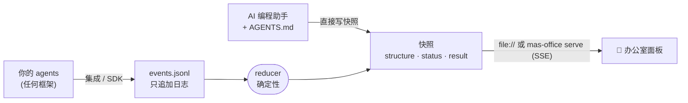

<div align="center">


# MAS Office

### 在一间小办公室里，实时看你的 AI agent 团队干活。

一个开放协议 + 一个动画办公室面板，适用于**任何**多智能体系统（multi-agent system）：<br>
OpenAI Agents SDK · LangGraph · Claude Agent SDK · Claude Code · 你自己的 Python / JS 代码。

[](https://github.com/weixijia/mas-office/actions/workflows/ci.yml)
[](https://www.npmjs.com/package/mas-office)
[](LICENSE)
[](spec/README.md)
[](https://github.com/weixijia/mas-office/stargazers)

[**项目网站与在线示例**](https://www.xijiawei.com/mas-office/) · [**快速开始**](#-快速开始) · [**框架接入**](#-接入你的框架) · [**协议**](spec/README.md) · [**文档**](docs/) · [**路线图**](ROADMAP.md) · [**参与贡献**](CONTRIBUTING.md) · [**English**](README.md)


</div>

---

多智能体系统很难"看见"：日志一路滚过，trace 嵌套十几层，团队之外的人根本看不出哪个 agent 卡住了、谁把什么交给了谁、检查员刚刚抓到了什么问题。

**MAS Office 给每个 agent 一张工位。** agent 工作、调用工具、交接、提出问题或失败时，画面实时变化；运行结束后，结果在旁边展开，每条结论都链接到来源。你的框架照常运行 agent，MAS Office 是看进这间办公室的那扇窗。

```bash
npx mas-office demo        # 30 秒，不需要 API key，不需要配置
```

## ✨ 为什么用 MAS Office

| | |
|---|---|
| 🏢 **是画面，不是日志** | 工位、交接路线、并行阶段、问题标记，还有给干完活的 agent 休息的休息区。产品经理、学生、凌晨两点的你，一眼就能看懂。 |
| 🔌 **任何框架，三行接入** | OpenAI Agents SDK、LangGraph、Claude Agent SDK、Claude Code hooks 都有现成集成；其他一切都能用[协议](spec/README.md)直接接。 |
| 🪶 **零依赖** | npm 和 Python 包只用标准库。不要账号、不要数据库、不要云服务。面板是纯 HTML，双击 `file://` 也能打开。 |
| 📜 **开放、有版本的协议** | 18 种事件类型，对齐 [AG-UI](https://docs.ag-ui.com)、[OpenTelemetry GenAI](https://opentelemetry.io/docs/specs/semconv/gen-ai/) 和 [A2A](https://a2a-protocol.org)。确定性 reducer、JSON Schema，以及两套参考 SDK 都必须通过的 conformance 用例。 |
| ⏪ **可回放的运行记录** | 每个项目一份只追加的 `events.jsonl`：可以回放、diff、提交进 git，或附在 bug 报告里。 |
| 🤖 **无代码模式** | 把 `AGENTS.md` 交给 Claude Code、Codex、Gemini CLI 或 Antigravity：AI 助手和你一起设计团队，再把每个角色作为真正的 subagent 跑起来，办公室实时显示。 |

## 🚀 快速开始

**先看效果**（Node ≥ 18）：

```bash
npx mas-office demo
```

一个五人团队规划里斯本周末：两个搜索员并行工作，预算检查员发现问题，规划员接手，运行中临时加入一个帮手，最后由 Lead 写出结果。

**在 Python 里用**（≥ 3.10，PyPI 版本即将发布）：

```bash
pip install "mas-office @ git+https://github.com/weixijia/mas-office#subdirectory=packages/python"
```

```python
from mas_office import Office

with Office(workspace="./runs") as office:
    run = office.project("headphone-deals", title="Headphone deals").run()
    finder = run.agent("finder", name="Retail finder", emoji="🔎")
    finder.working("Searching Currys", progress=30)
    finder.handoff("lead")
    finder.done()
    run.result(markdown="## Shortlist\n- Currys — £279")
    run.finish()
```

**在 JavaScript / TypeScript 里用**：`npm install mas-office`，然后 `import { Office } from 'mas-office'`，API 与 Python 一致（camelCase）。

**打开办公室：**

```bash
npx mas-office serve ./runs --open     # 通过 Server-Sent Events 实时更新
```

## 🔌 接入你的框架

| 框架 | 接入方式 | 状态 |
|---|---|---|
| OpenAI Agents SDK | `install(run)`，一个 `TracingProcessor` | 🧪 experimental |
| LangGraph | `for chunk in stream_to_office(graph.stream(...), run)` | 🧪 experimental |
| Claude Agent SDK | `ClaudeAgentOptions(hooks=office_hooks(run))` | 🧪 experimental |
| Claude Code | 在 `.claude/settings.json` 里加 `mas-office hook claude-code` | 🧪 experimental |
| AI 编程助手（`AGENTS.md`） | `npx mas-office init --kit my-team` | ✅ stable |
| CrewAI · AG-UI · OpenTelemetry · Google ADK · Mastra | 🙋 [欢迎贡献](https://github.com/weixijia/mas-office/issues?q=is%3Aissue+is%3Aopen+label%3A%22help+wanted%22) | — |

每个框架的完整示例见 [`docs/integrations.md`](docs/integrations.md)。

## 🧠 工作原理



- **事件进，画面出**：producer 只报告"发生了什么"，reducer 算出面板"现在该显示什么"。
- **处处结果一致**：JS 和 Python 两套 reducer 用同一批手工推算的 [conformance 用例](spec/conformance/)检验。
- **尽力报告，不中断任务**：emission 失败会警告并丢弃。File transport 同步写文件；HTTP transport 在后台批量发送事件。

## 🆚 和其他工具的区别

MAS Office 不是 tracing 平台，而是投在大屏上的那个视图。和你的 tracer 一起用：每个事件都能带 `trace` id。

| | **MAS Office** | Tracing 平台<br><sub>Langfuse, Phoenix, AgentOps</sub> | 框架自带工作台<br><sub>LangGraph Studio, AutoGen Studio</sub> |
|---|:---:|:---:|:---:|
| 团队级实时视图（谁在干活、谁在等、谁在检查） | ✅ | ➖ trace 树 | ✅ 图 |
| 跨框架 | ✅ | ✅ | ➖ 单一框架 |
| 无需账号、服务器或数据库 | ✅ | ➖ | ✅ |
| 非工程师也能看懂 | ✅ | ❌ | ➖ |
| 可以手写的开放文件协议 | ✅ | ➖ OTel | ❌ |
| prompt / token / 延迟调试 | ❌ 请用 tracer | ✅ | ✅ |

## 🤝 参与贡献

MAS Office 刻意保持小而可扩展：一个新框架集成通常只是**一个文件加一个用假数据驱动的测试**。从 [`good first issue`](https://github.com/weixijia/mas-office/issues?q=is%3Aissue+is%3Aopen+label%3A%22good+first+issue%22) 开始，再读 [CONTRIBUTING.md](CONTRIBUTING.md)。协议变更走轻量 [RFC 流程](spec/rfcs/README.md)，提交用 DCO（`git commit -s`）。

如果 MAS Office 对你有帮助，**点个 ⭐ 能让更多人看到它。**

## 🙏 致谢

MAS Office 源自 [awesome-mas](https://github.com/weixijia/awesome-mas)：一个教不写代码的人设计多智能体系统的课堂套件。事件模型借鉴了 AG-UI、OpenTelemetry GenAI、A2A 和 LangGraph 的事件流；"agent 是工位上的小人"这个想法受 pixel-agents 和斯坦福 Generative Agents 启发。

## 📄 License

[MIT](LICENSE) © Xijia Wei and MAS Office contributors.
