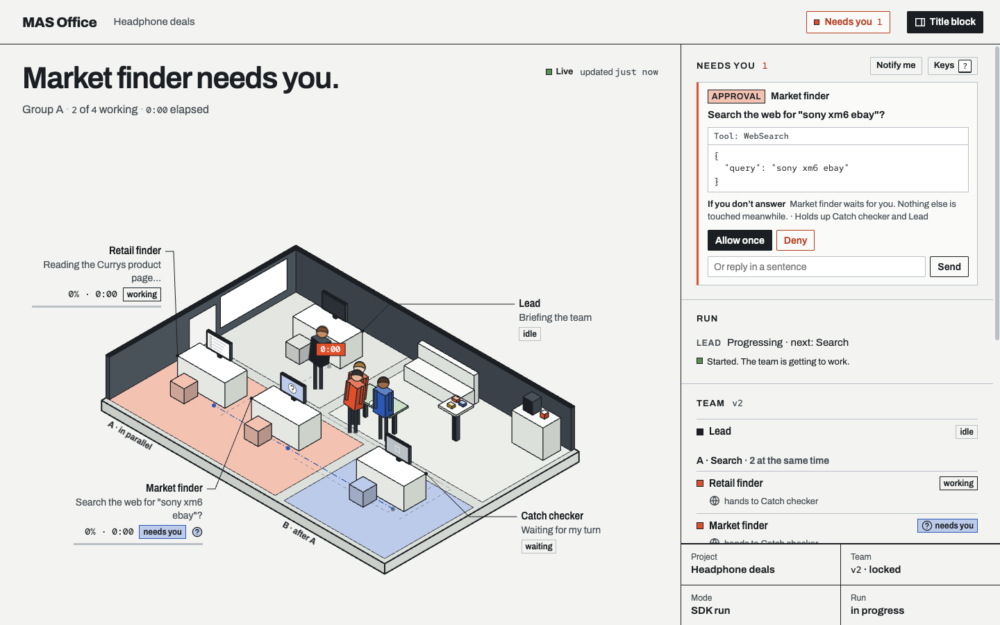
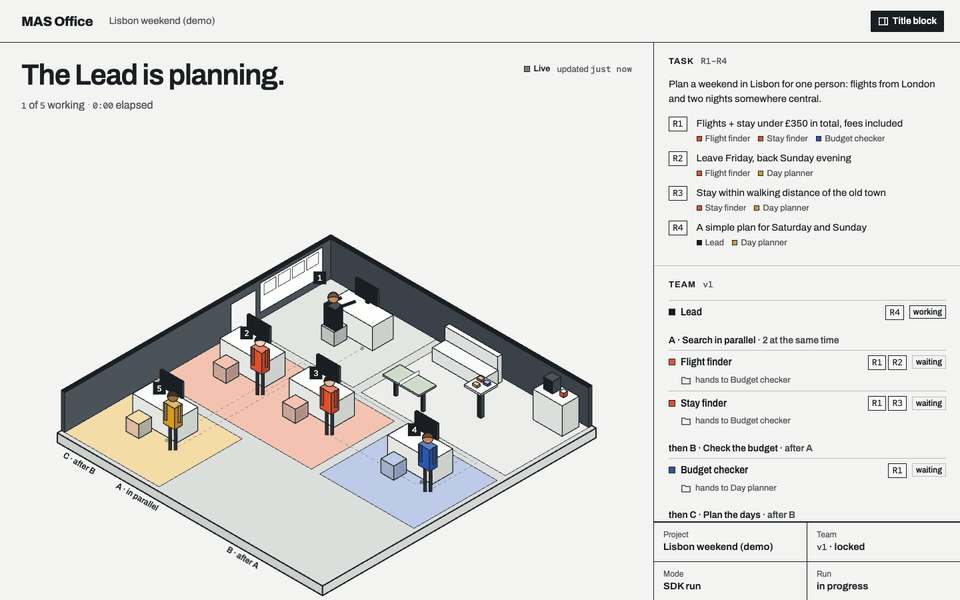
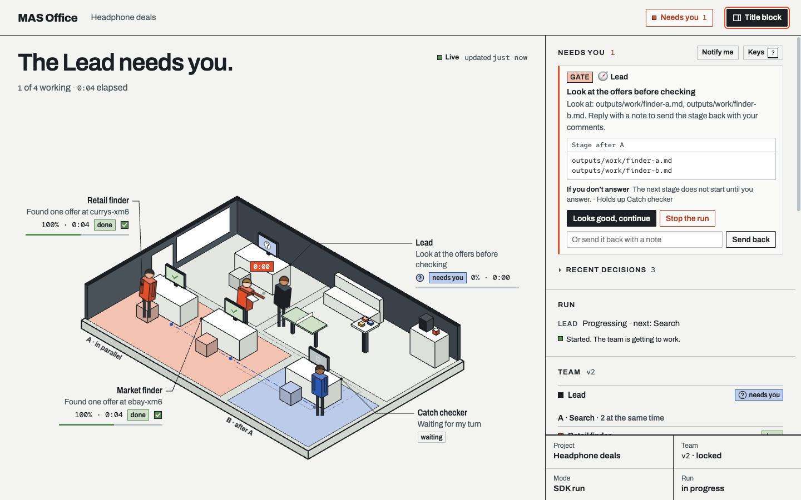
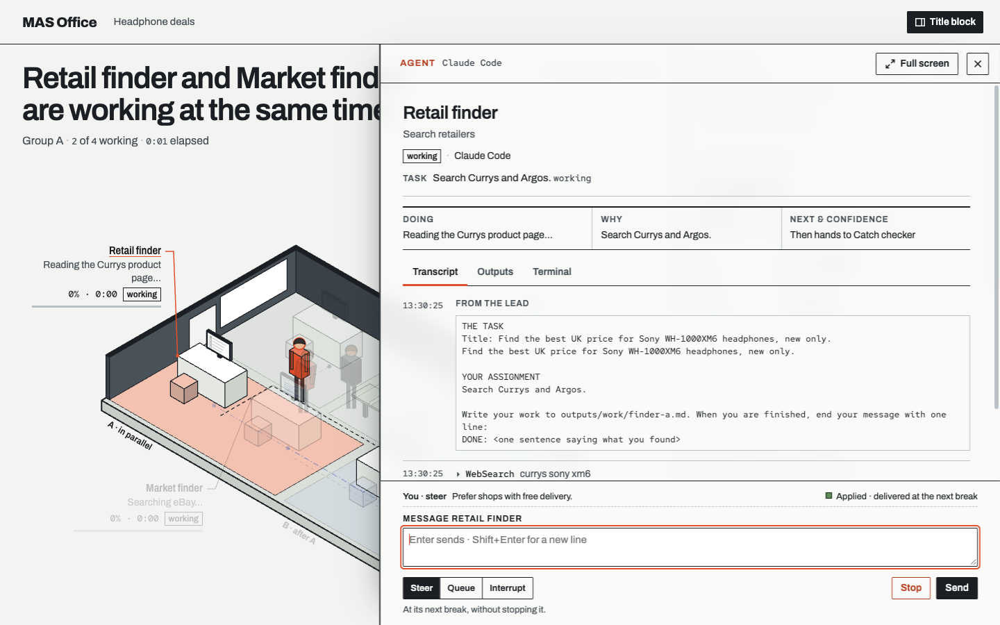
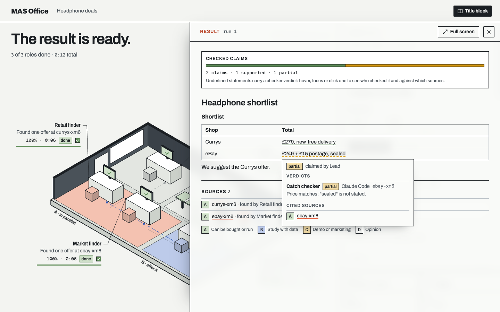
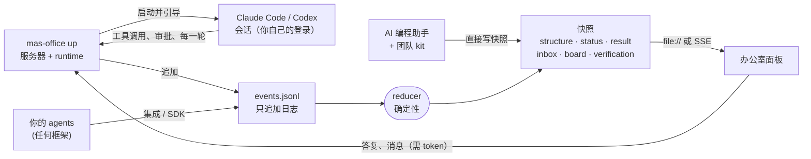

<div align="center">


# MAS Office

### 一支你自己设计、看得见、管得住、会自己核对工作的 AI 团队。

[](https://github.com/weixijia/mas-office/actions/workflows/ci.yml)
[](https://www.npmjs.com/package/mas-office)
[](LICENSE)
[](spec/README.md)
[](packages/node/README.md)
[](CONTRIBUTING.md)
[](https://github.com/weixijia/mas-office/stargazers)

[**项目网站**](https://www.xijiawei.com/mas-office/) · [**快速开始**](#快速开始) · [**设计团队**](#设计并锁定团队) · [**运行团队**](#运行团队) · [**核对**](#答案怎么核对) · [**其他框架**](#显示任何框架的团队) · [**命令行**](#命令行) · [**限制**](#目前的限制) · [**路线图**](ROADMAP.md) · [**English**](README.md)

</div>

团队里的每个角色都是你电脑上一个真实的 Claude Code 或 Codex 会话，由你自己登录。角色由你设计，设计由你锁定；调度工作、执行每个角色的工具权限的是普通代码。所有会话的工具审批、提问、卡住的角色、checker 标记和阶段检查点都进同一个 "Needs you" 收件箱，你在那里就地答复。拿回来的答案里，每条结论都标出来源，每个链接都被检查过，每条结论都由一个上下文干净的 checker 判定过。

第一个用例是调研和决策类任务：比价、行程规划、文献和可行性核查、产品和政策问题。

<p align="center">
  
  <br>
  <sub>"Needs you" 收件箱里有一条待处理的审批。本页截图都来自真实的面板、服务器和 engine；"Headphone deals" 的数据是编造的。</sub>
</p>

> **现状（v0.3.0）**：`mas-office up` 在真实的 Claude Code 和 Codex 会话上运行一支锁定的团队。办公室视图、带 JS 和 Python SDK 的事件协议、无代码团队 kit 照常可用。还没做的：可接手的原始终端 tab、评测运行、桌面 app。见[目前的限制](#目前的限制)。

## 快速开始

**看一支模拟团队**（Node ≥ 18，不需要登录）：

```bash
npx mas-office demo
```

它运行的是 npm 上已发布的 `mas-office` 0.2.2：一个五人团队在 0.2 的查看器里规划里斯本周末，没有收件箱，也没有 agent 抽屉。在 clone 下来的仓库里，`node packages/node/bin/mas-office.js demo` 会用 0.3.0 的面板播放同一支团队。

<details>
<summary><code>demo</code> 命令（0.2 查看器）</summary>
<br>

</details>

**在真实会话上运行团队。** 0.3.0 和新的 `mas-office-runtime` 包还没有发布到 npm，所以先从 clone 运行（Node ≥ 18.14）：

```bash
git clone https://github.com/weixijia/mas-office && cd mas-office
npm install                      # 链接 mas-office 和 mas-office-runtime
claude auth login                # 你自己登录
codex login                      # 示例里的 Catch checker 跑在 Codex 上

# 工作区放在 clone 之外：否则 Claude Code 会加载这个仓库的 CLAUDE.md。
mkdir -p ~/mas-work/deals/mas
cp examples/price-compare/mas/structure.js ~/mas-work/deals/mas/
node packages/node/bin/mas-office.js team check ~/mas-work/deals
node packages/node/bin/mas-office.js up ~/mas-work --project deals --open \
  --task "Find the best UK price for Sony WH-1000XM6 headphones, new, delivered within 3 days"
```

`up` 先报告 Claude Code 和 Codex 是否已安装、是否已登录，然后打印一个带访问 token 的面板链接（`--open` 会直接打开它）。示例设计已经锁定；改过之后要重新运行 `team lock`。0.3.0 发布后，同样的事就是 `npm install mas-office mas-office-runtime` 加 `npx mas-office up …`。下文的 `mas-office` 在 clone 里指 `node packages/node/bin/mas-office.js`。

## 设计并锁定团队

团队就是 `<project>/mas/structure.json`（或它的 `.js` 孪生文件）。团队设计 v2 在协议的 `structure` 上加了一组可选字段：每个角色的 `backend`、每个角色的工具及其 `allow` / `ask` / `deny`、reviewer 和审查轮数、关口、Lead 能替你批准的事、`budget` 和核对阈值。0.1 的 structure 依然有效。下面是 [`examples/price-compare`](examples/price-compare/mas/structure.js) 的一部分：

```jsonc
{
  "lead": {"id": "lead", "name": "Lead", "backend": "claude-code",
           "delegate": [{"effect": "allow", "kind": "approval", "tools": ["web search"]}]},
  "budget": {"maxParallel": 2},
  "groups": [{"id": "A", "label": "Search in parallel", "after": null},
             {"id": "B", "label": "Check", "after": "A"}],
  "roles": [
    {"id": "sony-deal-finder", "group": "A", "tools": ["web search"], "handsTo": "catch-checker", "…": "…"},
    {"id": "catch-checker", "group": "B", "backend": "codex", "tools": ["web search"],
     "reviewerOf": ["sony-deal-finder", "similar-model-finder"], "cleanContext": true,
     "review": {"maxRounds": 2, "onExceed": "ask-human"}, "handsTo": "lead", "…": "…"}
  ],
  "gates": [{"id": "g-offers", "after": "A", "kind": "stage",
             "title": "Look at the offers before they are checked", "blocking": true}],
  "verify": {"claims": true, "urlHealth": true}
}
```

**工具**来自一份固定词表，词表外的写法在锁定时就会被拒绝：

| 词 | 角色得到什么 |
|---|---|
| `web search` | 网页搜索和抓取页面 |
| `browse the web` | kit 的角色浏览器（`mas-browser`） |
| `read my files` | 项目 `raw/` 文件夹里你自己的文件 |
| `write notes` | 写它自己的文件（默认允许） |
| `run commands` | shell 命令 |
| `mcp:<server>` | 工作区 `.mcp.json` 里列出的某个 MCP server |
| `cli:<prefix>` | 以 `home/commands.json` 里列出的前缀开头的命令 |

每一项可以是一个词（effect 为 `allow`），也可以是 `{"name": "…", "effect": "allow" | "ask" | "deny"}`。每个角色都能读项目文件夹（没有 `read my files` 时不能读 `raw/`），只能写它自己的文件：`outputs/work/<role>*.md` 和 `sources/` 里的来源卡。有些规则不管设计怎么写都成立：从不读取凭证；从不写指令和设置文件（`CLAUDE.md`、`AGENTS.md`、`.claude/`、`.mcp.json` 等）；从不访问本机和私有地址；对整个项目文件夹做 Grep 或递归搜索会被拒绝，角色要给出更窄的文件夹，比如 `outputs/` 或 `sources/`。

**委托**（`lead.delegate`）：第一条匹配的规则决定一个审批。`allow` 按策略直接批准，`lead` 让 Lead 在你列出的工具和角色范围内决定，`human`（以及没有匹配的情况）交给你。关口、checker 标记和指定由人回答的请求始终交给你。

**检查、锁定、查看：**

```bash
mas-office team check <project>   # 列出设计里的所有问题（有错误时退出码为 1）
mas-office team lock <project>    # 检查，然后设置 "locked" 和签名
mas-office team show <project>    # 把设计打印成 Markdown：角色、工具、谁能批准什么
```

设计没有锁定，或者锁定后被改过，运行就会拒绝它。运行时，每个角色的工具会编译进它所在会话自己的选项，每一次工具调用都经过同一个决策点（`decideTool`）：放行、拒绝，或者送进收件箱。

## 运行团队

```bash
mas-office up <workspace> --project <p> --task "…" [--max-parallel 3] [--open] [--exit]
```

`up` 启动面板服务器并接上 runtime。不带 `--task` 时，在面板里发起运行。带 `--exit` 时，运行结束它就退出，运行没有完成则退出码为 1。一次运行的过程：

1. **规划。** Lead 本身也是一个真实会话，它读任务和团队，返回一份计划和每个角色的 brief。调度器是普通代码，Lead 返回的所有内容都会被它校验。
2. **阶段**按设计的顺序进行；同一阶段内的角色并行。默认最多同时 3 个角色工作（`--max-parallel`，1–12）。这个上限针对整个 `up` 进程、跨所有项目，Lead 不计入；设计里的 `budget.maxParallel` 可以把它调低。
3. **审查。** reviewer 用干净的上下文读它负责的人的产出，接受、附上意见打回，或者上报。超过 `review.maxRounds`，或者它选择上报，就由你决定。不会有任何东西被悄悄接受。
4. **检查点。** 阻塞型关口会在设计的位置停住运行，直到你选择继续、附上意见把这一阶段打回，或者停止运行。
5. **写答案。** Lead 把答案写到 `outputs/result.md`，每条结论都打上标签；然后核对这些结论（见[下文](#答案怎么核对)）。
6. **追问。** 在面板里对结果提问：Lead 要么直接根据已有文件回答，要么只把这个问题需要的角色派回去，答案作为新一轮加入。

<p align="center">
  
  <br>
  <sub>阶段检查点：检查阶段一直等着，直到你继续、附上意见打回这一阶段，或者停止。</sub>
</p>

**收件箱。** 所有会话里等人处理的事：工具审批、提问、决策（某个角色卡住了、要不要继续一次运行）、checker 标记和关口。每一项都显示它等了多久、卡住了什么、你不回答会怎样。办公室里同样的事显示为工位上举起的手。你委托出去的审批由策略或 Lead 决定，Lead 仍然可以把某一条转给你；每一次这样的决定都记在日志里，写明是谁做的。

- **Allow once、always allow、deny。** "Always allow" 只记住完全相同的那一次调用（同一个工具、同样的输入），只对这个 agent、只在这次运行里有效。
- **键盘。** `N` 跳到下一个需要你的 agent，`I` 跳到收件箱，`A` / `D` 批准或拒绝当前选中的请求，`1`–`9` 打开某个阶段，`?` 列出所有按键。

**引导一个 agent。** 点一个工位打开它的抽屉：实时记录、产出，以及一个直通它真实会话的聊天框。消息可以 *steer*（在它下一个间歇送达）、*queue*（当前这一轮结束后）或 *interrupt*；回执会显示会话实际怎么处理了它。*Stop* 结束这个 agent 当前的一轮。

<p align="center">
  
  <br>
  <sub>agent 抽屉：记录、产出，以及直通真实会话的聊天框，带送达回执。</sub>
</p>

**停滞和重启。** 一个角色在 `budget.stallMinutes`（默认 5 分钟）内没有进展，先提醒它一次；接着由 Lead 选一种恢复方式（重试、换一份 brief，或者问你）；再不行就由你决定。等人答复不算停滞。运行在 `budget.maxRunMinutes`（默认 90 分钟）、点 Stop 或按 Ctrl+C 时停止。运行没完成时重启 `up`，收件箱会问你要不要继续；已完成的角色不会重跑，这次运行的时间预算接着算。旧进程留下的待决请求会过期，agent 会重新提问。

**谁能答复。** `up` 和 `serve` 打印的面板链接里带一个 token。只有从这个链接打开的浏览器能答复请求、给 agent 发消息或发起运行；在别处（`file://`、项目网站、静态服务器）面板是只读的。`up` 运行期间，决策、判定、结果以及其他由 runtime 负责的事件只能由 runtime 或带 token 的面板写入，所以角色不能用一条 shell 命令给自己的工作作保。

**你自己打开的会话。** 装了 [`mas-office hook claude-code`](docs/integrations.md#claude-code-hooks-no-code) 后，你自己的 Claude Code 会话里的权限提示也会出现在收件箱里。你在自己的终端里答复；面板只是观察这个会话。

## 答案怎么核对

1. **结论。** Lead 的答案把每条陈述包在 `<claim id="c3" src="currys-xm6,ebay-xm6">…</claim>` 里；来源就是各角色写在 `sources/` 里的来源卡。
2. **链接。** 每个来源 URL 由普通代码检查，不用模型：可访问、有存档、失效或编造、被反爬墙拦住。私有和本机地址从不访问。
3. **判定。** 上下文干净的 checker（可以来自同一家或另一家厂商）对照引用的来源判定每条结论：supported、partial、contradicted 或 unknown。来源分级：**A**（能买到或能跑通）、**B**（有数据的研究）、**C**（演示或营销）、**D**（观点）。
4. **标记。** 超过设计里 `verify.flagWhen` 的阈值（例如出现一条被反驳的结论）时，收件箱里会开一个标记。
5. **在结果里**，结论按判定高亮；一行字统计核对过的结论和可访问的链接；"What the checkers caught" 列出被反驳的结论和被 reviewer 打回的工作。

<p align="center">
  
  <br>
  <sub>带核对结果的答案，以及其中一条结论的卡片：谁核对的、判定是什么、引用了哪个来源。</sub>
</p>

`mas-office verify <project>` 对任何答案（包括别的工具写的）执行第 1、2 步，并指出含数字、日期或最高级却没有 claim 标签的陈述。`--no-network` 只解析和计数。项目有事件日志时，结果会追加进去，面板随之显示。

"supported" 的意思是一个 checker 判断引用的页面支持这条结论，不等于结论为真。团队是否比单个 agent 给出更好的答案还没有测过：[`eval/`](eval/README.md) 里是做这个对比用的任务、团队设计和指标，评测还没有跑过。

## 用你自己的登录

- 每个角色运行的都是你电脑上安装的、未经修改的 `claude` 或 `codex`：Claude Code 通过 Anthropic 的 Agent SDK 指向你的 `claude`，Codex 通过你的 `codex app-server`。
- 你自己用 `claude auth login` 和 `codex login` 登录。MAS Office 只询问你是否已登录（`claude auth status`、Codex 的 `account/read`），从不读取、保存或转发凭证和 token，也从不提供自己的登录。
- 会话以最小的环境变量启动（你的 `PATH`、`HOME`、语言、终端和代理设置），不继承服务器自己的环境。Claude 角色不加载任何用户或项目设置；Codex 角色跑在只读 sandbox 里，在项目内用普通的读命令读文件，它的每一次写入都要经过策略批准。
- 运行消耗的是你自己的套餐额度。默认最多同时 3 个角色工作（可用 `--max-parallel` 调整），面板显示各程序自己报告的用量。
- `up` 只监听这台电脑（`127.0.0.1`），拒绝其他 `--host`。要从别的设备访问，请用 SSH 隧道或你自己的私有网络。

背后的规则见 [`CLAUDE.md`](CLAUDE.md) §3。

## 显示任何框架的团队

办公室视图适用于任何多 agent 系统。producer 把事件追加到 `<project>/mas/events.jsonl`（或 POST 给 `mas-office serve`），一个确定性的 reducer 把日志变成面板要画的快照。协议 0.2 增加了等人处理的请求、带回执的发回给 agent 的命令、任务、审查、结论、证据和判定。契约见 [`spec/README.md`](spec/README.md)；0.2 的说明见 [RFC 0001](spec/rfcs/0001-protocol-0.2.md)。

**JavaScript**（`npm install mas-office`；从 clone 安装：`npm install /path/to/mas-office/packages/node`）：

```js
import { Office } from 'mas-office';

const office = new Office({ workspace: './runs' });
const run = office.project('headphone-deals', { title: 'Headphone deals' }).run();
const finder = run.agent('finder', { name: 'Retail finder', emoji: '🔎' });
const checker = run.agent('checker', { name: 'Checker', emoji: '✅' });

finder.working('Searching Currys', { progress: 30 });
finder.source({ id: 'currys-xm6', title: 'Sony XM6 at Currys', url: 'https://www.currys.co.uk/', evidence: 'A' });

// Something that needs a person: it waits in the inbox until it is resolved.
const ask = finder.request('Include refurbished offers?', {
  kind: 'decision',
  options: [{ optionId: 'new', name: 'New only' }, { optionId: 'any', name: 'Refurbished is fine' }],
});
finder.resolve(ask, { optionId: 'new' });   // when your app has the answer
finder.handoff(checker);
finder.done('Found one offer');

// A claim, and a checker's verdict on it.
const c1 = run.claim('Currys sells the XM6 for £279 with free delivery.', { sources: ['currys-xm6'] });
checker.verdict(c1, 'supported', { sourceId: 'currys-xm6' });
checker.done();

run.result({ markdown: '## Shortlist\n- Currys: £279, free delivery' });
run.finish();
await office.close();
```

**Python**（≥ 3.10；还没有发布到 PyPI）：

```bash
pip install "mas-office @ git+https://github.com/weixijia/mas-office#subdirectory=packages/python"
```

```python
from mas_office import Office

with Office(workspace="./runs") as office:
    run = office.project("headphone-deals", title="Headphone deals").run()
    finder = run.agent("finder", name="Retail finder", emoji="🔎")
    finder.working("Searching Currys", progress=30)
    finder.source("currys-xm6", title="Sony XM6 at Currys", url="https://www.currys.co.uk/", evidence="A")
    ask = finder.request("Include refurbished offers?", kind="decision",
                         options=[{"optionId": "new", "name": "New only"},
                                  {"optionId": "any", "name": "Refurbished is fine"}])
    finder.resolve(ask, option_id="new")
    run.claim("Currys sells the XM6 for £279 with free delivery.", sources=["currys-xm6"])
    finder.done("Found one offer")
    run.result(markdown="## Shortlist\n- Currys: £279, free delivery")
    run.finish()
```

然后打开办公室：`mas-office serve ./runs --open`（通过 Server-Sent Events 实时更新）。分布在多个进程或多台机器上的 agent 可以共用一个 `serve`：`Office(url="http://127.0.0.1:4747")`。

SDK 还有 `stopped`、`usage`、`evidence` 和 `followUp`（Python 里是 `follow_up`），见 [`packages/node/README.md`](packages/node/README.md) 和 [`packages/python/README.md`](packages/python/README.md)。

| Producer | 状态 | 说明 |
|---|---|---|
| OpenAI Agents SDK（Python）：`install(run)` 加一个 tracing processor | experimental | [文档](docs/integrations.md#openai-agents-sdk-python) |
| LangGraph（Python）：`stream_to_office(graph.stream(...), run)` | experimental | [文档](docs/integrations.md#langgraph-python) |
| Claude Agent SDK（Python）：`ClaudeAgentOptions(hooks=office_hooks(run))` | experimental | [文档](docs/integrations.md#claude-agent-sdk-python) |
| Claude Code hooks：`mas-office hook claude-code` | experimental | [文档](docs/integrations.md#claude-code-hooks-no-code) |
| 通过 `AGENTS.md` 的 AI 编程助手 | stable | [kit](kit/AGENTS.md) |
| CrewAI · AG-UI · OpenTelemetry · Google ADK · Mastra · CAMEL | [欢迎贡献](https://github.com/weixijia/mas-office/issues?q=is%3Aissue+is%3Aopen+label%3A%22help+wanted%22) | [怎么写一个](CONTRIBUTING.md#2-framework-integrations) |

## 无代码 kit

```bash
npx mas-office init --kit my-team
```

用 Claude Code、Codex、Gemini CLI 或 Antigravity 打开 `my-team`，说一句 *"Read SETUP.md and follow it."*，你的助手就成了 Lead：它就任务访谈你，提出一支你可以用大白话调整的团队，锁定它，把每个角色作为上下文干净的独立 subagent 运行，最后写出一个每条结论都链接到分级来源卡的结果。追问只把需要的角色派回去。kit 不使用 runtime：由你打开的那个助手自己运行团队，办公室负责显示。

在 Claude Code 里第一次打开时选 **"Yes, I trust this folder"**，只有被信任的文件夹才会应用 kit 的设置。这些设置会把团队显示在 Claude Code 的状态行里，并给角色一个真实的浏览器（`mas-browser`：一个使用临时 profile、不带你任何登录、只能访问公网地址的 Chrome 窗口，需要安装 Google Chrome）。课堂版 [awesome-mas](https://github.com/weixijia/awesome-mas) 背后也是这个 kit。

## 命令行

| 命令 | 作用 |
|---|---|
| `mas-office demo` | 在临时工作区里跑一支模拟团队，自动启动服务并打开面板 |
| `mas-office up [workspace] --project <p> [--task "…"]` | 在真实的 Claude Code 和 Codex 会话上运行锁定的团队，附带面板和收件箱（需要 `mas-office-runtime`） |
| `mas-office serve [workspace]` | 面板在 `/office/`，工作区文件只读，`POST /v0/events`、`POST /v0/commands`（需 token），实时 `GET /v0/stream`（可回放） |
| `mas-office init [dir] [--kit]` | 新建带面板的工作区（以及无代码 kit） |
| `mas-office team check\|lock\|show <project>` | 检查团队设计、锁定并签名，或打印成 Markdown |
| `mas-office verify <project> [--no-network] [--json]` | 列出答案里的结论，检查每个来源链接，指出没有标签的陈述 |
| `mas-office validate [path]` | 用 JSON Schemas 检查快照和事件日志 |
| `mas-office reduce <project>` | 回放事件日志，重建快照 |
| `mas-office export --ag-ui <project>` | 把日志输出为 AG-UI 事件（实验性） |
| `mas-office hook claude-code` | 把 Claude Code hook 输入转成事件（实验性） |

`mas-office <command> --help` 列出每个命令的选项。没有 runtime 时，`serve` 把发给 agent 的命令留在 `<project>/mas/commands/<agentId>.jsonl`，供只读写文件的助手取走。

## 目前的限制

- 还没有原始终端 tab，也不能接手终端；计划做成可选包 `mas-office-terminal`。还不支持把官方 Codex TUI 接到角色的 thread 上。
- 在 Codex 0.167.0 下，sandbox 无法把 Codex 角色的读取限制在项目文件夹内。Codex 不经询问就执行的命令会在启动时由策略检查，被拒绝时当前这一轮会被中断，但很快的命令可能在中断前就已执行完。
- Codex 只报告 token，不报告费用，所以费用合计是下界。
- 中断一轮对话有单元测试覆盖，但还没在真实的 Claude Code CLI 上测过。
- 重启后不会重新接上待批准的请求：它会过期，agent 会重新提问。
- Lead 在规划、有请求转给它、出现停滞、写答案和追问时被唤醒；还不会在每个角色完成后收到一份摘要。
- `team show` 能打印 Markdown，但还不能从 Markdown 读回设计；请编辑 JSON。
- 无代码 kit 还没有迁到同一个 engine 上。
- 目前做过一次真实的端到端运行（2026-11-10：Lead 和一个 finder 跑在 Claude Code 上，checker 跑在 Codex 上；checker 把工作打回一次，第 2 轮接受）。评测还没有跑过，所以没有任何关于答案质量的测量。
- 0.3.0 还没有发布到 npm，Python SDK 还没有发布到 PyPI。

计划见 [ROADMAP.md](ROADMAP.md)；各版本的变化见 [CHANGELOG.md](CHANGELOG.md)。

## 工作原理



- **事件进，画面出。** producer 只报告发生了什么，reducer 算出面板现在该显示什么。
- **双向，同一份日志。** 等人处理的请求和发回给 agent 的命令跟其他事件写在同一份日志里。命令本身从不改变 agent 的状态，只有会话随后报告的事实才会。
- **处处结果一致。** JS 和 Python 两套 reducer 用同一批 16 个手工推算的 [conformance 用例](spec/conformance/)检验。0.1 的日志归约结果不变，只多了两个新的 status 字段。
- **能回放的运行。** 每个项目是一份只追加的 `events.jsonl`；每个 agent 的完整对话另存在 `mas/transcript/<agent>.jsonl`。

细节：[架构](docs/architecture.md) · [runtime 设计](docs/design/runtime.md) · [协议](spec/README.md) · [协议 0.2 RFC](spec/rfcs/0001-protocol-0.2.md) · [前人工作](docs/research/prior-art.md)。

## 仓库结构

| 路径 | 内容 |
|---|---|
| [`packages/node/`](packages/node/README.md) | npm 上的 `mas-office`，零依赖：JS SDK、reducer、服务器、团队设计与编译、审批策略、核对、面板、CLI |
| [`packages/runtime/`](packages/runtime/README.md) | `mas-office-runtime`：Claude Code 和 Codex adapter，以及 `mas-office up` 背后的 engine |
| [`packages/python/`](packages/python/README.md) | Python SDK、reducer 和框架集成 |
| `panel/` | 办公室面板：纯 HTML 和 JS，没有构建步骤 |
| [`spec/`](spec/README.md) | 协议、JSON Schemas、conformance 用例、RFC |
| [`kit/`](kit/AGENTS.md) | 无代码 `AGENTS.md` kit |
| [`eval/`](eval/README.md) | 评测框架：任务、锁定的设计、指标、用户研究方案 |
| `examples/` | 完成的示例工作区 |
| [`docs/`](docs/architecture.md) | 架构、集成指南、设计文档、调研笔记 |
| [`references/`](references/manifest.json) | 固定版本的开源参考代码（按需拉取，不提交） |

## 参与贡献

一个新框架集成通常只是一个文件加一个用假数据驱动的测试。从 [`good first issue`](https://github.com/weixijia/mas-office/issues?q=is%3Aissue+is%3Aopen+label%3A%22good+first+issue%22) 和 [`help wanted`](https://github.com/weixijia/mas-office/issues?q=is%3Aissue+is%3Aopen+label%3A%22help+wanted%22) 开始，再读 [CONTRIBUTING.md](CONTRIBUTING.md)；coding agent 从 [CLAUDE.md](CLAUDE.md) 开始。协议变更走轻量的 [RFC 流程](spec/rfcs/README.md)，提交用 DCO（`git commit -s`），不用 CLA。

```bash
git clone https://github.com/weixijia/mas-office && cd mas-office && npm install
npm test                                                        # SDK、CLI、runtime、面板
PYTHONPATH=packages/python/src python -m pytest packages/python -q   # Python SDK
node packages/node/bin/mas-office.js validate examples          # 示例工作区
git diff --check
PYTHONPATH=packages/python/src:eval python -m pytest eval -q    # 评测框架
```

能整合好的开源成果，我们就不重写。[`references/manifest.json`](references/manifest.json) 固定了我们参考的开源项目，[`docs/design/reuse-map.md`](docs/design/reuse-map.md) 记录 MAS Office 的每个部分该读哪些文件，以及是依赖、改编还是只借思路。

请遵守[行为准则](CODE_OF_CONDUCT.md)，安全漏洞请私下报告（[SECURITY.md](SECURITY.md)）。

<a href="https://star-history.com/#weixijia/mas-office&Date">
  
</a>

<a href="https://github.com/weixijia/mas-office/graphs/contributors">
  
</a>

## 引用

如果你在研究或教学中用到 MAS Office，请引用：

```bibtex
@software{wei2026masoffice,
  author  = {Wei, Xijia and {MAS Office contributors}},
  title   = {{MAS Office}: a live office for designing, watching and checking AI agent teams},
  year    = {2026},
  url     = {https://github.com/weixijia/mas-office},
  version = {0.3.0}
}
```

## 致谢

MAS Office 源自 [awesome-mas](https://github.com/weixijia/awesome-mas)：一个教不写代码的人设计多智能体系统的课堂套件。事件模型借鉴了 [AG-UI](https://github.com/ag-ui-protocol/ag-ui)、[OpenTelemetry GenAI semantic conventions](https://github.com/open-telemetry/semantic-conventions-genai)、[A2A](https://a2a-protocol.org) 和 LangGraph 的事件流；"agent 是工位上的人"这个想法受 [pixel-agents](https://github.com/pixel-agents-hq/pixel-agents) 和斯坦福 [Generative Agents](https://github.com/joonspk-research/generative_agents) 启发。runtime、收件箱和核对层参考的更多开源项目列在[复用地图](docs/design/reuse-map.md)里。字体：Archivo 和 Red Hat Mono（SIL Open Font License）。

## License

[MIT](LICENSE) © Xijia Wei and MAS Office contributors。改编自其他项目的代码在 [`THIRD_PARTY_NOTICES.md`](THIRD_PARTY_NOTICES.md) 里署名。产品名称和 logo 归各自所有者。
