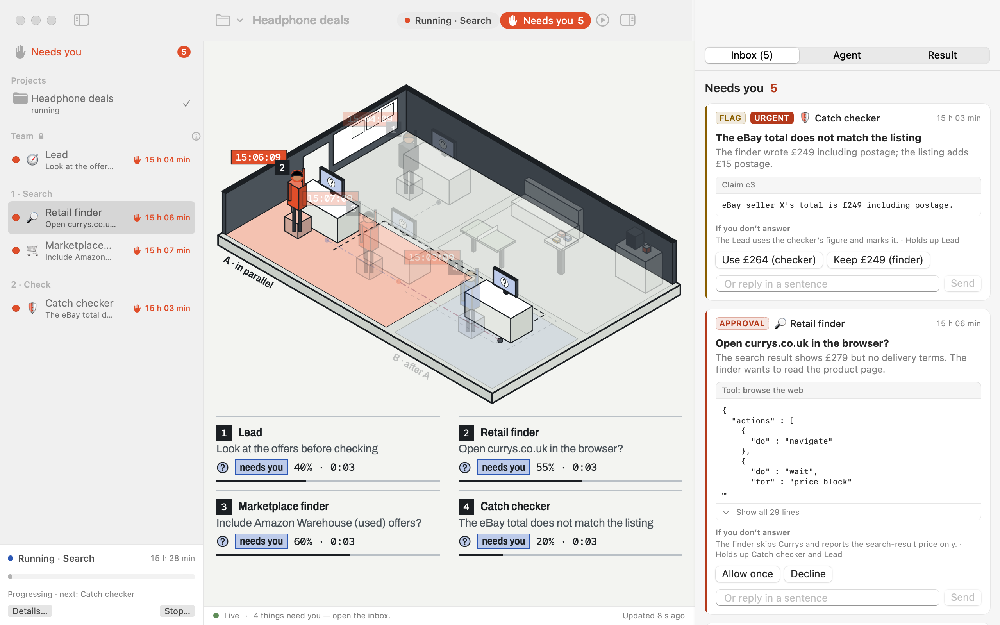

# MAS Office for Mac

A native macOS app (SwiftUI and AppKit) for running and supervising a MAS Office team. The inbox, the agent page with its transcript and chat, the result with its checked claims, the run controls, the team design, settings and the setup check are native views. The isometric office is the same drawing as the web panel, shown in a web view. The engine is the same `mas-office up` as on the command line, started by the app as a child process.



*Rendered from a fixture with made-up data.*

## What it needs

- macOS 14 or later.
- Node.js 18.14 or later, already installed. The app finds it through your login shell, the way a terminal would; you can also set the path in Settings → Advanced.
- Claude Code and/or Codex, installed and signed in **by you** in Terminal (`claude auth login`, `codex login`). The app shows whether each is ready and which command to run. It has no sign-in of its own and never reads, stores or forwards credentials.

## Build and run

There is no Xcode project; the package builds with the Swift toolchain of the Command Line Tools.

```bash
apps/mac/scripts/build-app.sh          # → apps/mac/build/MAS Office.app
apps/mac/scripts/build-app.sh --dmg    # also a disk image
open "apps/mac/build/MAS Office.app"
```

The bundle contains the app, its icon, an example team design, and a copy of `mas-office`, `mas-office-runtime` and the Claude Agent SDK's JavaScript (without any bundled command-line binary: the runtime uses the `claude` you installed). It is signed ad hoc. On your own Mac it opens normally; on another Mac, Gatekeeper asks for a right-click → Open until the app is signed with a Developer ID and notarised.

## What is where

| Path | What |
|---|---|
| `Sources/MASOfficeKit/` | Models of the protocol's documents, the HTTP client, the event stream, `OfficeStore` (what the views bind to), the engine process control, login-shell environment discovery, and the supervision rules ported from `panel/inbox.js` |
| `Sources/MASOffice/` | The app: main window, inbox, agent page, result, run controls, team design, setup check, settings, menus, menu bar item, notifications |
| `Sources/MASOfficeChecks/` | The checks, as an executable (`swift test` needs Xcode) |
| `scripts/` | `build-app.sh`, `integration-check.sh` and a scripted engine for checks |

## Checks

```bash
swift build --package-path apps/mac
swift run --package-path apps/mac MASOfficeChecks     # unit and parity checks (needs node)
apps/mac/scripts/integration-check.sh                 # the store against the real server with scripted sessions
apps/mac/scripts/integration-check.sh --render /tmp/mas-renders --fixture panel/tests/fixtures/mock-supervise
```

The integration check uses scripted sessions: it starts no Claude Code or Codex session and uses nobody's plan. `--render` writes PNGs of every view, in light and dark, so layout can be reviewed without a screen.

Launch arguments for development: `--workspace <dir>`, `--attach-url <url> --attach-token <token>` (use an engine that is already running), `--self-check <file.json>` (run briefly, write a report, quit), `--render <dir>`.

## How it behaves

- The token that lets the app answer requests lives in memory only. It is handed to the office web view by script, never in its address, and is redacted from the engine log.
- Closing the window keeps the app in the menu bar, where the item shows how many things need you. Quitting while roles are working asks first, then stops the engine; the engine also stops by itself when the app goes away.
- A notification is sent only for a blocking request that has waited 30 seconds while the app is in the background, once per wait. An approval with one allow and one deny option can be answered from the notification.

## Limits

- Not signed with a Developer ID, not notarised, no automatic updates.
- Built and checked on Apple silicon with macOS 27; Intel is not tested.
- Hover, click and keyboard on claims, notification delivery, and window restore were checked by rule and by render, not by driving a real screen.
- The raw terminal tab is a note, as in the web panel.
