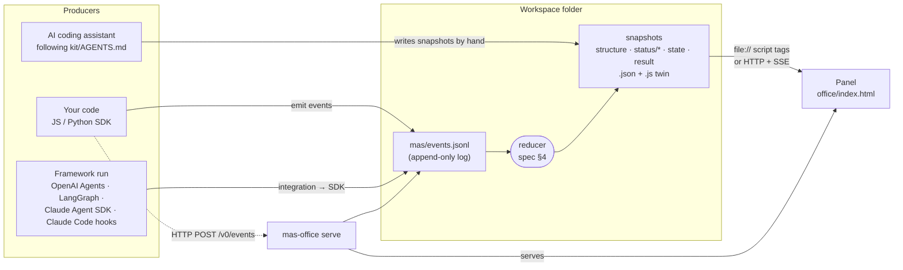

# Architecture

MAS Office separates **who produces** a multi-agent run from **how it is shown**. Everything in between is plain files with a written contract ([`spec/README.md`](../spec/README.md)).

## Why files?

- **Every producer can write a file.** An AI coding assistant that only has a "write file" tool can drive the panel; so can a shell script.
- **Nothing to run to look at it.** The panel opens from `file://` — the `.js` twins load as script tags, which browsers allow where `fetch` is blocked.
- **Replayable and diffable.** The event log is the history of a run; `mas-office reduce` rebuilds every snapshot from it, and it can be committed, shared or attached to a bug report.

## Why an event log *and* snapshots?

Snapshots are what a viewer needs (who is doing what *now*); events are what producers naturally have (something just happened). The deterministic reducer connects the two, so producers never have to compute the panel's state, and every implementation agrees because they all pass the same [conformance cases](../spec/conformance/). This mirrors AG-UI's split between state snapshots and deltas, and LangGraph's rule that a strictly increasing `seq`, not the clock, orders events.

## Components

| Component | Responsibility | Never does |
|---|---|---|
| Reducer (JS + Python) | events → snapshots, exactly per spec §4 | I/O |
| File transport | synchronously append to `events.jsonl`, reduce, write snapshots atomically, keep `home/projects` current | raise emission failures into agent code |
| HTTP transport | batch events to `mas-office serve` | block or raise into agent code |
| `mas-office serve` | serve panel + workspace read-only, accept events, push changes over SSE | write outside the workspace, accept non-local traffic by default |
| Panel | draw the office from snapshots | execute agent-written HTML, write anything |
| Kit (`AGENTS.md`) | let an assistant design and run a team by writing snapshots | depend on any package |

## Concurrency model

- **File transport: one writer process per project.** Threads inside that process are fine (the SDKs lock per project). For several processes, run `mas-office serve` and use the HTTP transport — the server is then the single writer and assigns `seq`.
- Snapshot files are replaced atomically (write a temp file, then rename), so the panel never reads half a file. If it does read a broken file (e.g. hand-written by an assistant), it keeps the last good version and shows a warning.

## Static website embedding

For an immutable example on a static host, use `office/index.html?root=../examples/price-compare/&static=1`. The explicit `static=1` option loads the complete snapshot once, skips the `/v0/health` probe and SSE connection, and disables repeated snapshot polling. Desk selection, the result view and office animation still work. Adding `&demo=1` keeps the simulated demo timeline running. Reload the iframe to fetch newer files.

Without `static=1`, the panel retains its normal live-server detection and fallback polling. Use that default when following a workspace that changes during a run.

## Topologies

- `staged`: declared groups that run in parallel, one after another (`after`). Matches crews, sequential/parallel pipelines and supersteps.
- `dynamic`: agents appear at runtime (`agent.registered`, or any event from an unknown agent). Matches supervisors, swarms and subagent spawning.
- `graph`: declared edges only (`handsTo`); laid out like `staged` in v0.1, with a DAG layout on the [roadmap](../ROADMAP.md).
