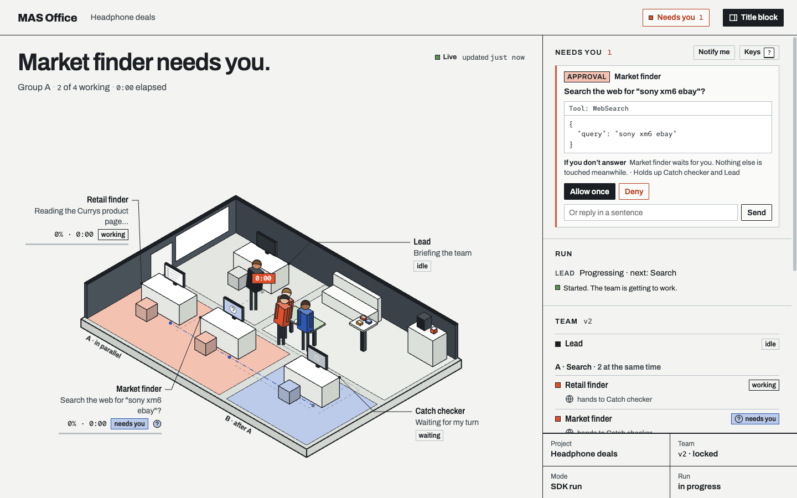

# mas-office

The core package of [MAS Office](https://github.com/weixijia/mas-office): an AI team you design, can watch, can steer, and that checks its own work.



Zero dependencies, Node ≥ 18. The package holds:

- **SDK** (`import … from 'mas-office'`): emits [protocol 0.2](https://github.com/weixijia/mas-office/blob/main/spec/README.md) events, runs the reference reducer and writes the snapshot files the panel reads.
- **Server** (`mas-office serve`): the panel, the workspace files (read-only), an event API, a command API for answering requests and messaging agents (with the panel token), and a live stream with replay.
- **Team design** (`mas-office/team`): team design v2, its checker, lock and signature, the compiler into per-role session options, and `decideTool`, the one decision point for every tool call. Delegated approvals are in `mas-office/policy`.
- **Verification** (`mas-office/verify`): claim tags, source cards, link health checks (private addresses are never fetched) and checker verdicts.
- **Panel**: the office, the "Needs you" inbox, the agent drawer and the result with checked claims. Plain HTML and JS, shipped inside the package.
- **CLI** (`mas-office …`): ten commands, listed below. `mas-office up` runs a locked team on real Claude Code and Codex sessions; it needs the separate [`mas-office-runtime`](https://github.com/weixijia/mas-office/blob/main/packages/runtime/README.md) package, which depends on the Claude Agent SDK.

## Install

```sh
npx mas-office demo                           # a simulated team in the panel, no sign-in
npm install mas-office                        # the SDK and the `mas-office` command
npm install mas-office mas-office-runtime     # also run teams of real sessions (Node ≥ 18.14)
```

From a clone of the repository (for contributors): `npm install` at the root links both packages, and `node packages/node/bin/mas-office.js` stands for `mas-office`. To use the SDK from a clone, `npm install /path/to/mas-office/packages/node`.

## Run a team

```sh
claude auth login                                    # sign in yourself (and `codex login` for Codex roles)
npx mas-office team lock <workspace>/<project>       # check and sign mas/structure.json
npx mas-office up <workspace> --project <project> --task "…" --open
```

Every role is the unmodified `claude` or `codex` on your computer, signed in by you; MAS Office never sees your sign-in. A step-by-step start with an example team is in the [README](https://github.com/weixijia/mas-office#quick-start); how to design a team, what a run does and what the inbox shows follow from there.

## SDK

```js
import { Office } from 'mas-office';

const office = new Office({ workspace: './runs' });
const run = office.project('headphone-deals', { title: 'Headphone deals' }).run();
const finder = run.agent('finder', { name: 'Retail finder', emoji: '🔎' });
const checker = run.agent('checker', { name: 'Checker', emoji: '✅' });

finder.working('Searching Currys', { progress: 30 });
finder.source({ id: 'currys-xm6', title: 'Sony XM6 at Currys', url: 'https://www.currys.co.uk/', evidence: 'A' });
const ask = finder.request('Include refurbished offers?', {
  kind: 'decision',
  options: [{ optionId: 'new', name: 'New only' }, { optionId: 'any', name: 'Refurbished is fine' }],
});
finder.resolve(ask, { optionId: 'new' });
finder.handoff(checker);
finder.done('Found one offer');

const c1 = run.claim('Currys sells the XM6 for £279 with free delivery.', { sources: ['currys-xm6'] });
checker.verdict(c1, 'supported', { sourceId: 'currys-xm6' });
checker.done();

run.result({ markdown: '## Shortlist\n- Currys: £279, free delivery' });
run.finish();
await office.close();
```

Then show it: `mas-office serve ./runs --open`.

| Call | Event |
|---|---|
| `new Office({ workspace })` / `new Office({ url })` | choose a transport (below) |
| `office.project(folder, { title?, task? })` | opens `<workspace>/<folder>/`; `task` (`{summary, requirements: [{id, text}]}`) is written to `me/task.json` |
| `project.run({ structure?, title?, runId? })` | `run.started`; pass a [structure](https://github.com/weixijia/mas-office/blob/main/spec/README.md#21-structure) for a declared team |
| `run.agent(id, { name, emoji, job, group, handsTo, parent, role })` | an agent handle; `agent.registered` the first time an agent that is not in the structure acts |
| `run.lead` | the Lead's handle (id `lead`) |
| `agent.working(say, { progress })`, `agent.status(state, {...})` | `agent.status` |
| `agent.say(text, { to })` | `message` |
| `await agent.tool(name, fn, { say })` | `tool.started` → `tool.finished` / `tool.failed` (the error is re-thrown) |
| `agent.source({ id, title, url, evidence })` | `artifact` (a source card) |
| `agent.handoff(to, { say, reason })` | `handoff` |
| `agent.flag(text, { kind })`, `agent.resolve()` | `flag.raised`, `flag.resolved` |
| `agent.request(title, { kind, options, … })` | `request.opened`; returns the request id |
| `agent.resolve(requestId, { optionId, outcome, note, by })` | `request.resolved` |
| `agent.stopped(reason, { scope })`, `agent.usage({ inputTokens, outputTokens, costUsd })` | `agent.stopped`, `usage` |
| `agent.claim(text, { sources })`, `run.claim(…)` | `claim.added`; returns the claim id |
| `agent.evidence(sourceId, { url, urlHealth, grade, quote })` | `evidence.checked` |
| `agent.verdict(claimId, status, { sourceId, note })` | `verdict.recorded` |
| `agent.done(say)`, `agent.fail(reason)` | `agent.finished`, `agent.failed` |
| `run.result({ markdown, work, sources, flags, title })` | `result` |
| `run.followUp(question)` | `round.started`: the next `result` is a new round |
| `run.finish(say)`, `run.fail(reason)` | `run.finished`, `run.failed` |
| `project.emit(event)` | any event (low level) |
| `await office.close()` | flush the HTTP queue |

Ids are lowercase letters, digits and dashes (`[a-z0-9-]`). Invalid project folders or agent ids throw a `TypeError` when you create the handle. **Emitting never throws**: an event that is invalid or cannot be delivered is dropped with one `console.warn`, so the panel can never break your agents.

### Transports

**File**: `new Office({ workspace: './runs' })`. Each event is appended to `<project>/mas/events.jsonl` and applied to an in-memory reducer; the snapshots (`mas/structure`, `mas/state`, `mas/status/<id>`, `mas/inbox`, `mas/board`, `outputs/result`, `outputs/verification`, `home/projects`, as JSON plus the `.js` twins the `file://` panel loads) are rewritten atomically. Reopening a project continues the log's `seq` numbering. Use one writer process per project; for several processes, run `mas-office serve` and use HTTP.

**HTTP**: `new Office({ url: 'http://127.0.0.1:4747' })`. Events are queued and posted in batches to `POST /v0/events?project=<folder>`; the server assigns `seq` and writes the log and snapshots. A batch stays under the 1 MB body limit; a single larger event is dropped with one warning. Call `await office.close()` before exiting.

### Other entry points

- `mas-office`: also `createReducer()`, `reduce(lines)`, `parseLog(lines)`, `validateEvent(event)`, `writeSnapshots(projectDir, snapshot)`, `readDocument`, `jsTwin`, `parseJsTwin`, `ProjectLog`, `updateProjectsIndex`, `SPEC_VERSION`. `reduce` is the reference implementation of [spec §4](https://github.com/weixijia/mas-office/blob/main/spec/README.md#4-the-reducer) and passes every case in `spec/conformance/`.
- `mas-office/team`: `normalizeTeam`, `lockTeam`, `signTeam`, `verifySignature`, `stageOrder`, `compileRole`, `compileLead`, `decideTool`, `teamToMarkdown`.
- `mas-office/policy`: `matchDelegation`.
- `mas-office/verify`: `parseClaims`, `readSourceCards`, `checkSources`, `checkUrl`, `uncitedSentences`, `summarize`, `shouldFlag`.
- `mas-office/server`: `startServer({workspace, port, host})` resolves to `{url, port, token, emit, log, attach, close()}`.
- `mas-office/cli`: `await main(['validate', './runs'])` returns the exit code.

The contract between this package and the runtime is [`docs/design/runtime.md`](https://github.com/weixijia/mas-office/blob/main/docs/design/runtime.md).

## CLI

| Command | What it does |
|---|---|
| `mas-office demo [--port 4747] [--no-open] [--exit] [--speed 1]` | serve a temporary workspace and play a simulated team |
| `mas-office up [workspace] [--project p] [--task "…"] [--max-parallel 3] [--open] [--exit]` | run a locked team on real sessions, with the panel (needs `mas-office-runtime`; listens on this computer only) |
| `mas-office serve [workspace] [--port 4747] [--host 127.0.0.1] [--open]` | serve the panel at `/office/`, the workspace files (read-only) and the API |
| `mas-office init [dir] [--kit] [--force]` | create a workspace with the panel in `office/`; `--kit` adds the no-code `AGENTS.md` kit |
| `mas-office team check\|lock\|show <project>` | check a team design, lock it with a signature, or print it as Markdown |
| `mas-office verify <project> [--no-network] [--json]` | list an answer's claims, check each source link, point at untagged statements |
| `mas-office validate [path]` | check a workspace, project or file against the JSON Schemas; exit 1 on errors. `.js` twins are read as data, never run |
| `mas-office reduce <project>` | rebuild every snapshot from `mas/events.jsonl` |
| `mas-office export --ag-ui <project>` | print the log as AG-UI events, NDJSON (experimental) |
| `mas-office hook claude-code [--workspace dir] [--project claude-code]` | turn Claude Code hook input into events (experimental) |

Exit codes: `0` success, `1` the command failed, `2` wrong usage. `mas-office <command> --help` lists every option.

### The server API

| Endpoint | |
|---|---|
| `POST /v0/events?project=<folder>` | one event, a JSON array or NDJSON (max 1 MB). The server assigns `seq`, appends to the log and rewrites the snapshots. A batch with any invalid event is rejected as a whole (`400`). `command.*` events are refused here; a `request.resolved` that claims a person answered needs the token; while a runtime is attached (`up`), the events it owns (requests, tasks, reviews, claims, verdicts, results, …) need the token too. |
| `POST /v0/commands?project=<folder>` | token. A message, answer, assignment or interrupt for one agent. Without a runtime, commands are left in `<project>/mas/commands/<agentId>.jsonl` for a file-only assistant. |
| `POST /v0/runs?project=<folder>` | token, runtime only. `{"task": "…"}` starts a run; `{"followUp": "…"}` asks about the last result. |
| `GET /v0/stream?project=&since=` | Server-Sent Events: `change` when a workspace file changes, `mas` for each event; `since` (or `Last-Event-ID`) replays the log first. |
| `GET /v0/inbox?project=<folder>`, `GET /v0/session`, `GET /v0/health` | the inbox snapshot; whether the caller's token is valid and a runtime is attached; `{"ok": true, "spec": "0.2"}` |

The printed panel link carries the token; only a browser opened from it can answer requests, message agents or start runs. The server listens on `127.0.0.1` by default, never serves files outside the workspace or hidden files, and refuses non-loopback `Host` headers while bound to loopback. Workspace files are written by agents, so they are served as data: the panel has a strict `Content-Security-Policy`, workspace files are sandboxed, and workspace `.html`, `.svg`, `.xml` and `.mjs` files are sent as `text/plain`.

### Claude Code hooks

Add `mas-office hook claude-code` as a command hook for `SessionStart`, `UserPromptSubmit`, `PreToolUse`, `PostToolUse`, `PostToolUseFailure`, `SubagentStart`, `SubagentStop`, `Notification` and `Stop` in `.claude/settings.json` ([full snippet](https://github.com/weixijia/mas-office/blob/main/docs/integrations.md#claude-code-hooks-no-code)). Use a global install or an absolute path to `bin/mas-office.js`, not `npx`: hooks run on every tool call. By default events go to `.mas-office/claude-code/` in your project (`--workspace` changes the folder); watch them with `mas-office serve .mas-office --open`. A permission prompt in that session also appears in the inbox; you answer it in your terminal. The hook always exits 0 and prints nothing; problems are logged to `.mas-office/home/hook-errors.log`.

## License

MIT. Code adapted from other projects is credited in [THIRD_PARTY_NOTICES.md](https://github.com/weixijia/mas-office/blob/main/THIRD_PARTY_NOTICES.md).
